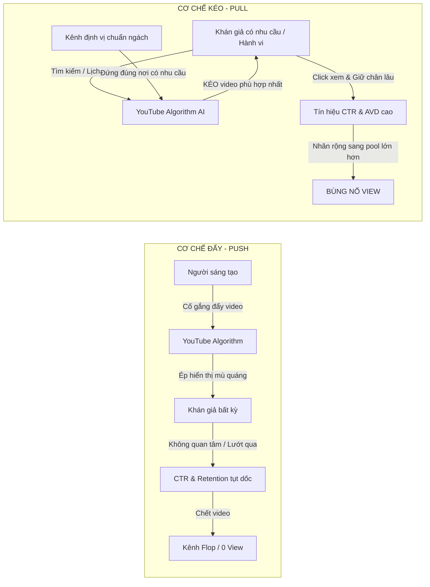
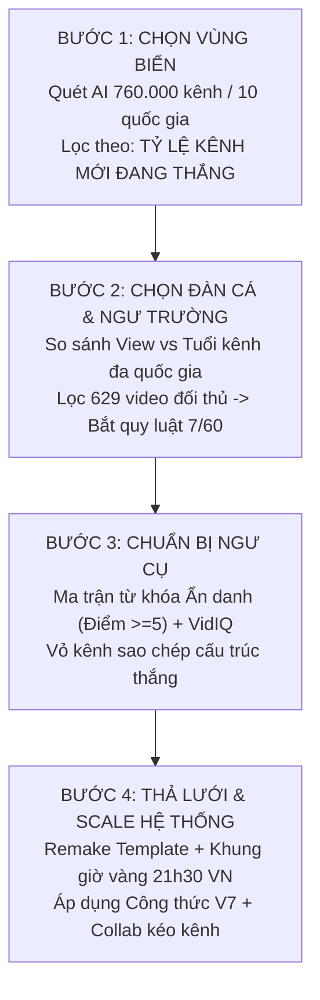
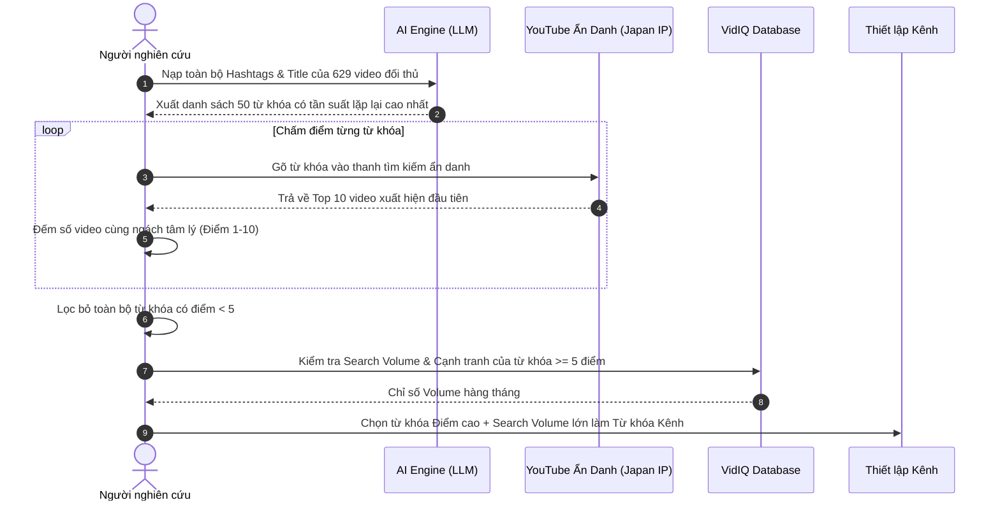
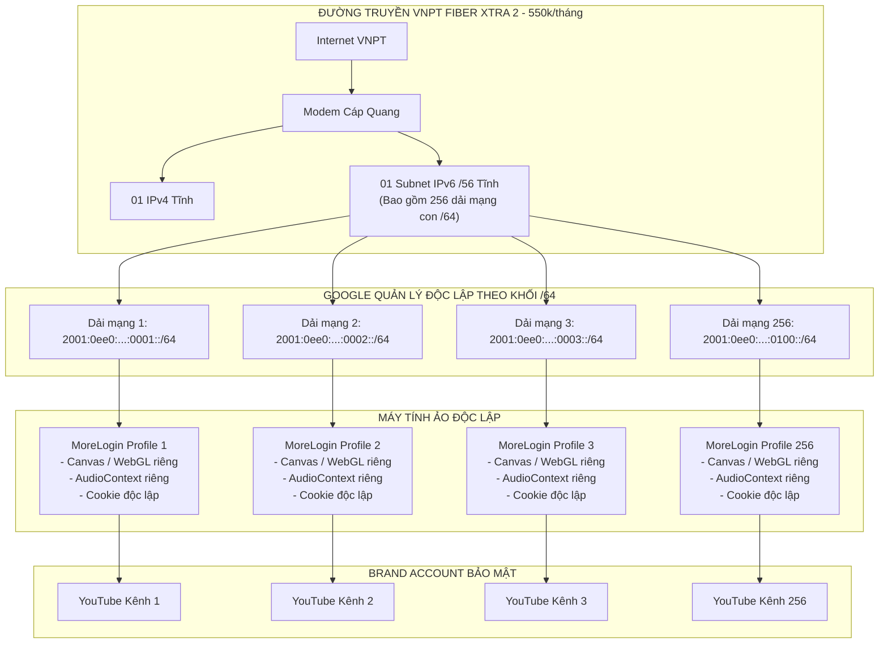
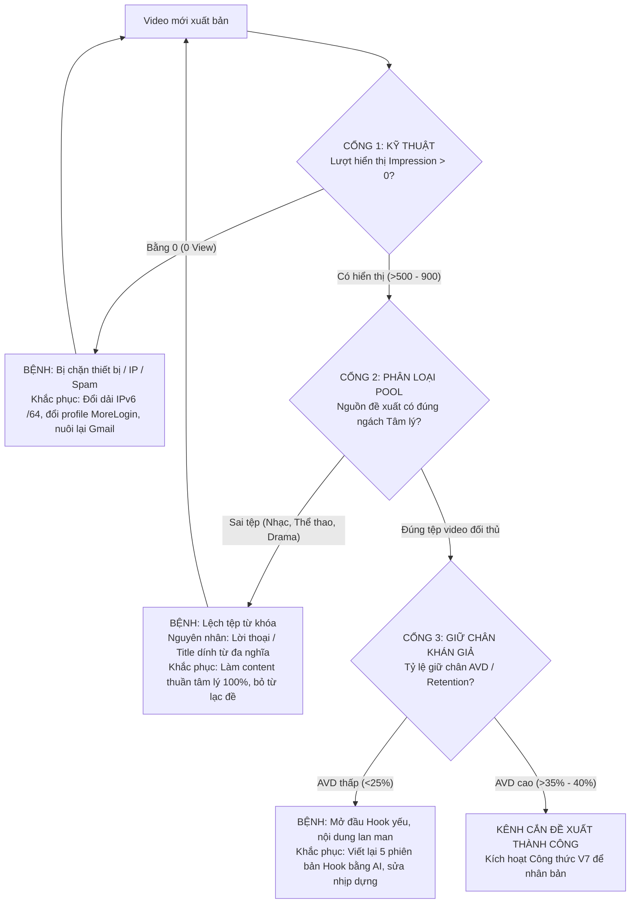
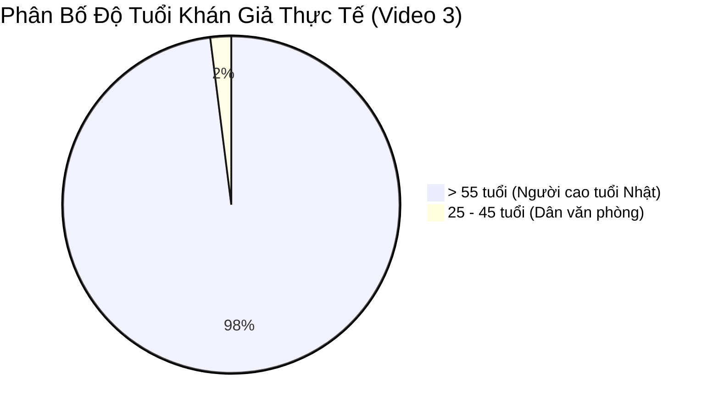
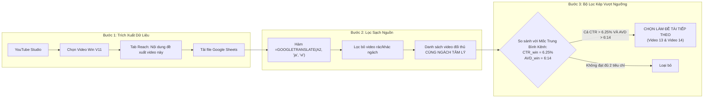
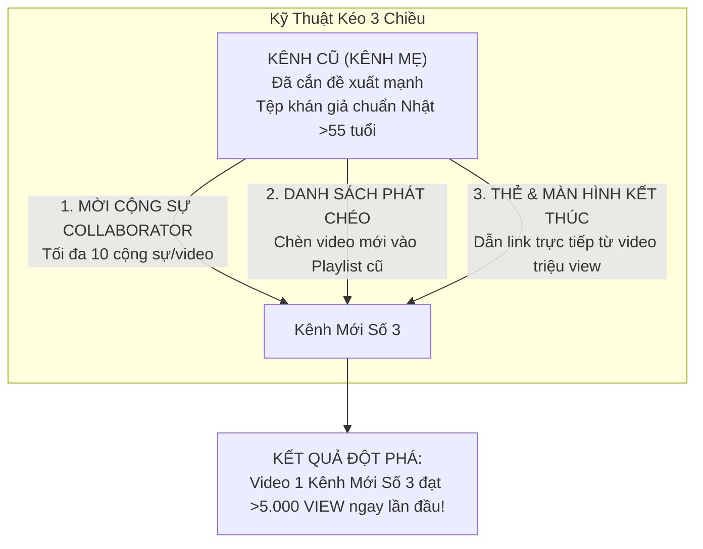

# CẨM NANG TOÀN THƯ THỰC CHIẾN YOUTUBE VIEW NGOẠI
## PHÂN TÍCH BÓC TÁCH VI MÔ CHUỖI "HÀNH TRÌNH 30 NGÀY KIẾM TIỀN VỚI YOUTUBE" (TÁC GIẢ: AN ONG)

---

> [!IMPORTANT]
> **Tuyên ngôn phương pháp luận:** 
> "YouTube tìm video cho người xem, chứ không tìm người xem cho video. Người làm YouTube thành công không bao giờ đi tìm khán giả, mà phải đứng đúng chỗ khán giả đang đứng. Biết dùng công cụ AI sẽ ngày càng phổ biến và bớt hiếm dần; thứ tạo nên tài sản định giá hàng chục nghìn đô-la chính là sự hiểu nghề sâu sắc (Domain Expertise) được đóng gói thành các thuật toán và quy trình cho hệ thống AI Agent." — **An Ong**

---

## MỤC LỤC TỔNG QUAN

1. [Bản Đồ Tổng Quan & Hệ Tiên Đề Khởi Nguyên](#1-bản-đồ-tổng-quan--hệ-tiên-đề-khởi-nguyên)
2. [Triết Lý & Nguyên Lý Gốc Của Thuật Toán YouTube (Cơ Chế Kéo vs Đẩy)](#2-triết-lý--nguyên-lý-gốc-của-thuật-toán-youtube-cơ-chế-kéo-vs-đẩy)
3. [Phương Pháp Nghiên Cứu Ngách 4 Bước & Công Thức % Kênh Mới Thắng](#3-phương-pháp-nghiên-cứu-ngách-4-bước--công-thức--kênh-mới-thắng)
4. [Kỹ Thuật Ma Trận Từ Khóa & Quy Trình Chấm Điểm Ẩn Danh (Incognito + VidIQ)](#4-kỹ-thuật-ma-trận-từ-khóa--quy-trình-chấm-điểm-ẩn-danh-incognito--vidiq)
5. [Kiến Trúc Hạ Tầng Mạng & Bảo Mật Cách Ly Chống Chết Chùm](#5-kiến-trúc-hạ-tầng-mạng--bảo-mật-cách-ly-chống-chết-chùm)
6. [Quy Trình 3 Bước Bắt Bệnh YouTube Studio & Bài Học Xương Máu](#6-quy-trình-3-bước-bắt-bệnh-youtube-studio--bài-học-xương-máu)
7. [Quy Luật Chu Kỳ 12 Giờ Của "Cỗ Máy Đi Chào Hàng" & Khung Giờ Đăng Vàng](#7-quy-luật-chu-kỳ-12-giờ-của-cỗ-máy-đi-chào-hàng--khung-giờ-đăng-vàng)
8. [Giải Mã Toàn Tập "Công Thức V7" (V7 Formula Architecture)](#8-giải-mã-toàn-tập-công-thức-v7-v7-formula-architecture)
9. [Chiến Lược Dùng Kênh Cũ Kéo 3 Kênh Mới (Cross-Channel Synergy)](#9-chiến-lược-dùng-kênh-cũ-kéo-3-kênh-mới-cross-channel-synergy)
10. [Kiến Trúc Doanh Nghiệp 1 Người 30.000$ (Hệ Thống 8 AI Agent Trên Proxmox/VPS)](#10-kiến-trúc-doanh-nghiệp-1-người-30000-hệ-thống-8-ai-agent-trên-proxmoxvps)
11. [Bộ Checklist SOP Thực Hành Chuẩn Hóa Từng Ngày (Ngày 1 - 30)](#11-bộ-checklist-sop-thực-hành-chuẩn-hóa-từng-ngày-ngày-1---30)

---

## 1. BẢN ĐỒ TỔNG QUAN & HỆ TIÊN ĐỀ KHỞI NGUYÊN

### 1.1. Bối cảnh & Động lực thực chiến
* **Tác giả:** An Ong (Nhà sáng lập nền tảng ShopAPI / Kiến trúc sư hệ thống AI Automation YouTube).
* **Vấn đề cốt lõi:** Làm YouTube view ngoại luôn là "chiếc cúp khó đoạt nhất" trong giới MMO (Make Money Online). Hầu hết người mới thất bại vì:
  1. Sản xuất nội dung theo cảm tính, không dựa trên dữ liệu định lượng.
  2. Bị khóa tài khoản, hạn chế hiển thị (0 view / shadowban) do dùng chung IP và thiết bị.
  3. Bỏ cuộc giữa chừng vì không hiểu độ trễ phân phối của thuật toán.
* **Hình mẫu kiểm chứng (Benchmark):** Vợ của tác giả đạt phong độ xuất sắc: **5 kênh liên tiếp làm kênh nào bật kiếm tiền kênh đó (YPP)**. Trong một ngày bật đồng thời 2 kênh:
  * Kênh A: Đạt điều kiện YPP chỉ sau **9 video** (thực tế video thứ 8 đã đủ số liệu).
  * Kênh B: Đạt điều kiện YPP sau **30 video**.
  * Quy tắc bất di bất dịch: Không có bất kỳ kênh nào vượt quá 30 video mà chưa bật được kiếm tiền trong vòng 30 ngày.
* **Mục tiêu thử nghiệm:** An Ong cam kết tuân thủ 100% công thức kỷ luật này trong chuỗi 30 ngày, công khai toàn bộ số liệu minh bạch, kể cả những thất bại, lệch tệp và lỗi kỹ thuật.

### 1.2. Chiến lược "Remake / Remix" có bản quyền
Thay vì tự nghĩ ra chủ đề từ con số 0 (xác suất thất bại $>95\%$), mô hình tập trung vào kỹ thuật **Remake (Z-Mech)**:
* Phân tích các nội dung đã được chứng minh thắng lợi (Proof of Concept) của đối thủ ngoại.
* Tái cấu trúc lại kịch bản, nâng cấp hình ảnh minh họa bằng AI, tối ưu hóa móc câu (Hook) và cải thiện thời lượng giữ chân (Retention).
* Tự động hóa sản xuất thông qua Template chuẩn hóa kết hợp công cụ sinh video.

---

## 2. TRIẾT LÝ & NGUYÊN LÝ GỐC CỦA THUẬT TOÁN YOUTUBE (CƠ CHẾ KÉO VS ĐẨY)



### 2.1. Bản chất: Kéo (Pull) thay vì Đẩy (Push)
* **Nguyên lý gốc được YouTube công bố:** *"YouTube tìm video cho người xem, chứ không tìm người xem cho video."*
* Thuật toán YouTube là một hệ thống phản ứng (reactive system), không phải hệ thống phát tán chủ động (active push). Thuật toán phục vụ **khán giả**, mục tiêu tối thượng là giữ chân người dùng ở lại trên nền tảng YouTube càng lâu càng tốt để hiển thị quảng cáo.
* Do đó, người sáng tạo nội dung không đi "săn tìm khán giả". Nhiệm vụ tối cao là: **Xác định chính xác vị trí khán giả đang tụ tập và đặt nội dung của mình đúng vào luồng tìm kiếm / luồng quan tâm đó.**

### 2.2. Cơ chế Gom cụm Đa chiều (Multi-Dimensional Audience Clustering)
Thuật toán AI của YouTube (sử dụng Deep Neural Networks gồm 2 giai đoạn: *Candidate Generation* và *Ranking*) phân loại video và khán giả thông qua các Vector không gian đa chiều (Embeddings):
1. **Quét dữ liệu thô (Multimodal Ingestion):**
   * Quét văn bản: Tiêu đề (Title), Mô tả (Description), Thẻ từ khóa (Tags), Thẻ băm (Hashtags).
   * Quét âm thanh (Voice-to-Text): Chuyển hóa toàn bộ giọng nói đọc trong video thành văn bản tự động để phân tích ngữ nghĩa tự nhiên (NLP).
   * Quét thị giác (Computer Vision): Nhận diện các đối tượng, ký tự chữ (OCR) trên Thumbnail và từng khung hình (frames) của video.
2. **Gán nhãn & Định vị Pool (Traffic Pools):**
   * Nếu nội dung video được gán nhãn chính xác (ví dụ: `Psychology_Introvert_Japan`), AI sẽ đặt video vào nhóm đề xuất bên cạnh các video cùng cụm.
   * Nếu tiêu đề hoặc lời thoại xuất hiện các từ khóa thuộc trường nghĩa khác (ví dụ: `thể thao`, `ca nhạc`, `bóc phốt`), AI sẽ phân vân hoặc gán nhầm video vào **Pool Thể Thao** hoặc **Pool Giải Trí**.
3. **Hệ quả của việc lệch Pool:** Khi video tâm lý bị đặt cạnh video bóng đá hay bài tập dưỡng sinh, khán giả thể thao sẽ bỏ qua không click (CTR rơi xuống mức thảm hại $<2\%$). AI của YouTube lập tức kết luận: *"Đây là một video kém chất lượng, người xem không thích"* $\rightarrow$ Thuật toán lập tức cắt phân phối (Kill Impressions).

### 2.3. Hai nguồn giao thông huyết mạch của Kênh
| Nguồn Giao Thông | Bản Chất Khán Giả | Yếu Tố Quyết Định Thắng Lợi | Vị Trí Hiển Thị |
| :--- | :--- | :--- | :--- |
| **Tính năng duyệt xem (Browse Features)** | **Khách Lạnh (Cold Audience):** Lướt trang chủ, chưa từng biết kênh, tâm lý phòng thủ cao. | Thumbnail phải giật đòn tâm lý cực mạnh; **Hook 60s đầu** phải ghim chặt vấn đề; Chữ Thumbnail phải cực lớn. | Trang chủ ứng dụng YouTube trên Mobile, Smart TV hoặc Web. |
| **Video đề xuất (Suggested Videos)** | **Khách Ấm (Warm Audience):** Đang xem dở một video cùng chủ đề của đối thủ, có sẵn sự hứng thú. | Phù hợp ngữ cảnh liên đới; Tiêu đề hứa hẹn giải quyết góc nhìn sâu hơn; Áp dụng triệt để **Công thức V7**. | Cột bên phải (Desktop) hoặc danh sách cuộn ngay bên dưới video đang phát (Mobile). |

---

## 3. PHƯƠNG PHÁP NGHIÊN CỨU NGÁCH 4 BƯỚC & CÔNG THỨC % KÊNH MỚI THẮNG

### 3.1. Ẩn dụ "Nghề Đánh Cá" trên đại dương YouTube
An Ong đúc kết quy trình xây dựng kênh YouTube tương đương với một ngư dân chuyên nghiệp:
* **Bước 1: Chọn vùng biển (Niche Discovery):** Tìm chủ đề lớn có dòng hải lưu mạnh và nguồn cá dồi dào.
* **Bước 2: Chọn đàn cá & Ngư trường (Market & Content Pillar):** Xác định quốc gia mục tiêu và tuyến nội dung thu hút đàn cá mục tiêu.
* **Bước 3: Chuẩn bị ngư cụ (Channel Setup & SEO Matrix):** Chuẩn bị vỏ kênh, ma trận từ khóa chuẩn hóa và tài nguyên sạch.
* **Bước 4: Thả lưới & Kéo cá (Production & Optimization):** Sản xuất hàng loạt theo mẫu, đo lường chu kỳ và nhân bản quy mô.



### 3.2. Công thức Định lượng Sống còn: % Kênh Mới Thắng
Thay vì nhìn vào số lượng view khổng lồ để chọn ngách (sai lầm phổ biến nhất của người mới), phải đo lường khả năng chen chân của một kênh mới toanh.

$$\mathbf{Tỷ\ lệ\ Kênh\ Mới\ Thắng\ (\%)} = \frac{N_{kênh\ mới\ (\le 12\ tháng\ tuổi)\ sở\ hữu\ video\ > 100.000\ view}}{N_{tổng\ số\ kênh\ sở\ hữu\ video\ > 100.000\ view\ trong\ ngách}} \times 100\%$$

* **Ngưỡng an toàn (Benchmark):**
  * $\mathbf{\% < 10\%}$: **VÙNG ĐỎ (Tử địa).** Thị trường đã bão hòa, các ông lớn thâu tóm toàn bộ đề xuất. Kênh mới vào tỷ lệ chết $>95\%$.
  * $\mathbf{10\% \le \% \le 30\%}$: **VÙNG VÀNG (Cạnh tranh vừa).** Đòi hỏi kỹ thuật sản xuất và tối ưu rất cao.
  * $\mathbf{\% \ge 40\%}$: **VÙNG XANH (Mỏ vàng cho kênh mới).** Thuật toán đang tích cực tìm kiếm các nhà sáng tạo mới, cửa biển rộng mở.

### 3.3. Đối chiếu thực tế: Ngách Kinh Dị vs Ngách Tâm Lý Học Nhật Bản
Bảng dữ liệu trích xuất từ 760.000 kênh phân tích bằng AI của An Ong:

| Chỉ Số Đo Lường | Ngách Kinh Dị (Horror Stories) | Ngách Tâm Lý Học (Psychology - Nhật) | Phân Tích Ý Nghĩa Thực Chiến |
| :--- | :--- | :--- | :--- |
| **Số video $>100k$ view** | **154 video** | Hơn 130 video | Nhìn bề ngoài, ngách kinh dị trông như "mỏ vàng đại dương". |
| **Tuổi kênh trung vị** | $> 36 - 60$ tháng | **13 tháng** (Nhật: dưới 5.3 tháng) | Ngách tâm lý học có vòng đời đối thủ cực trẻ. |
| **% Kênh Mới Thắng** | **Chỉ 3%** | **47%** (Tại Nhật đạt **100%**) | **3% ở ngách kinh dị là cạm bẫy:** Toàn bộ cá lớn đã bị các tàu đại dương lâu năm chiếm lĩnh. Người mới vào sẽ bị đè bẹp hoàn toàn. |
| **Khảo sát thị trường Nhật** | Khó chuyển ngữ văn hóa sợ hãi | **17/17 kênh đều $< 5.3$ tháng** | Tại Nhật Bản, 100% kênh tâm lý đang thắng đều là kênh mới (Ví dụ: kênh 10 video đạt 19k view, kênh 30 video đạt 23k view). |
| **Quyết định đầu tư** | ❌ **LOẠI BỎ NGAY** | ✅ **CHỌN LÀM VÙNG BIỂN CHÍNH** | Quyết định dồn 100% nguồn lực vào ngách Tâm lý học thị trường Nhật Bản. |

### 3.4. Quy luật Pareto 7/60 trong Tuyến Nội Dung
Sau khi chọn thị trường Nhật Bản, nhóm An Ong dùng công cụ kéo toàn bộ **629 video** của đối thủ về máy, sắp xếp theo thứ tự lượt xem giảm dần:
* **Con số giật mình:** Chỉ có **7%** tổng số video đạt mốc $>100.000$ view.
* Nhưng **7% video này lại ôm trọn tới 60% tổng lượng xem** của toàn bộ ngách!
* **Chiến lược hành động:**
  1. Không sáng tạo nội dung ngẫu hứng. Chỉ tập trung mổ xẻ và "remake" nhóm 7% tinh hoa này.
  2. Tư duy video đầu tiên: Không phục vụ người xem bình thường, mà phục vụ việc **huấn luyện cho bot AI của YouTube hiểu kênh thuộc tệp nào**.
  3. Chiến lược chia 3 tuyến nội dung ban đầu để gieo xác suất:
     * *Tuyến A:* Tâm lý hướng nội & sự cô đơn của người trưởng thành.
     * *Tuyến B:* Tâm lý giao tiếp và đọc vị người khác chốn công sở.
     * *Tuyến C:* Triết lý nhân sinh và khoảng trống tâm lý tuổi trung niên/cao niên.
     * Tuyến nào cắn đề xuất trước sẽ lập tức dồn toàn bộ nguồn lực vào tuyến đó.

---

## 4. KỸ THUẬT MA TRẬN TỪ KHÓA & QUY TRÌNH CHẤM ĐIỂM ẨN DANH (INCOGNITO + VIDIQ)

### 4.1. Nguyên tắc vàng: "Không sáng tạo những gì đã win"
Những gì đối thủ đang thắng tức là thị trường đã bỏ phiếu chấp thuận. Bộ nhận diện thương hiệu của kênh mới (Avatar, Banner, Phong cách dòng tiêu đề) được chuẩn hóa trực tiếp từ đối thủ thành công nhất: Dùng nhân vật hoạt họa/anime phong cách trầm tư, nền tối, chữ sắc nét đặc trưng của thị trường Nhật.

### 4.2. Quy trình 5 bước Chấm điểm Từ khóa Ẩn danh (Incognito Scoring System)



* **Bước 1 (Trích xuất tần suất):** Đưa toàn bộ Title, Description và Hashtags của 629 video đối thủ vào AI. Yêu cầu trích xuất danh sách các cụm từ khóa (cả Kanji và Hiragana) xuất hiện nhiều nhất.
* **Bước 2 (Thiết lập môi trường sạch):** Mở trình duyệt Chrome ở chế độ **Ẩn danh (Incognito)**, chuyển đổi ngôn ngữ hiển thị sang tiếng Nhật và khu vực sang Nhật Bản (hoặc sử dụng Proxy Nhật). Mục tiêu: Xóa bỏ hoàn toàn lịch sử tìm kiếm cá nhân để xem kết quả khách quan của thuật toán.
* **Bước 3 (Thao tác tìm kiếm & Đếm đối thủ):** Gõ từng từ khóa vào ô tìm kiếm. Quan sát kỹ **Top 10 video** hiển thị ở trang đầu tiên.
* **Bước 4 (Công thức Chấm điểm Ẩn danh 1 - 10):**
  $$\text{Điểm Từ Khóa} = \text{Số lượng video thuộc ngách Tâm Lý xuất hiện trong Top 10}$$
  * *Ví dụ A:* Gõ từ khóa `人間関係 心理学` (Tâm lý học quan hệ con người) $\rightarrow$ Xuất hiện 8 video tâm lý giống đối thủ, 2 video khác $\rightarrow$ **Đạt 8/10 Điểm** (Cực chuẩn ngách).
  * *Ví dụ B:* Gõ từ khóa `一人 時間` (Thời gian một mình) $\rightarrow$ Xuất hiện 2 video tâm lý, 4 video vlog du lịch, 4 video ca nhạc $\rightarrow$ **Đạt 2/10 Điểm** (Từ khóa bị loãng tệp).
  * **Quy tắc cứng:** Chỉ lưu lại các từ khóa đạt **$\ge 5$ điểm**.
* **Bước 5 (Đối soát Volume bằng VidIQ):**
  * Nhập danh sách từ khóa $\ge 5$ điểm vào công cụ **VidIQ**.
  * Thu thập chỉ số *Monthly Search Volume* (Lượng tìm kiếm hàng tháng).
  * Từ khóa chuẩn để cài vào ô Từ khóa Kênh (Channel Keywords) phải hội tụ 2 điều kiện: **Điểm Ẩn danh $\ge 5$ và Search Volume cao**.

---

## 5. KIẾN TRÚC HẠ TẦNG MẠNG & BẢO MẬT CÁCH LY CHỐNG CHẾT CHÙM

### 5.1. Rủi ro "Chết Chùm" (Cross-Contamination) trong YouTube MMO
Khi một hệ thống quản trị nhiều kênh trên cùng một máy tính và đường truyền thông thường:
* Thuật toán chống gian lận của Google liên kết các tài khoản qua 3 lớp: **Địa chỉ IP mạng**, **Vân tay trình duyệt (Browser Fingerprint)**, và **Thông tin tài khoản (Gmail/SĐT/Recovery)**.
* Nếu 1 kênh bị phạt bản quyền hoặc bị đánh dấu spam, thuật toán sẽ truy quét theo dải IP và vân tay phần cứng, dẫn đến việc toàn bộ các kênh còn lại bị bóp nghẹt hiển thị (0 view) hoặc bay màu hàng loạt ("chết chùm").
* **Bài học Ngày 12 của An Ong:** Đăng nhập đồng thời 4 kênh trong cùng một buổi làm việc $\rightarrow$ Google quét hành vi bất thường, ngay lập tức 3 kênh bị rơi vào tình trạng **0 view tuyệt đối**.



### 5.2. Giải pháp Mạng: VNPT Fiber Xtra 2 (550.000 VNĐ/tháng)
* **Thông số kỹ thuật gói cước:** Cung cấp **01 IPv4 tĩnh** và **01 khối Subnet IPv6 /56 tĩnh**.
* **Nguyên lý toán học của Subnet IPv6:**
  * Độ dài chuẩn của một mạng con IPv6 cục bộ (Local Subnet) theo chuẩn IETF là `/64` ($2^{64}$ địa chỉ IP).
  * Khối mạng nhà mạng cấp là `/56`. Số lượng dải mạng con `/64` độc lập được tạo ra là:
    $$N = 2^{(64 - 56)} = 2^8 = \mathbf{256\ dải\ mạng\ con\ IPv6\ /64}$$
* **Cơ chế kiểm duyệt của Google đối với IPv6:**
  * Khác với IPv4 (bị quản trị theo từng IP đơn lẻ hoặc dải `/24`), trong giao thức IPv6, do không gian địa chỉ quá lớn, Google quản lý danh tiếng và chống spam theo **đơn vị từng khối `/64`**.
  * Do đó, 256 dải `/64` này được hệ thống bảo mật của Google coi là **256 đường mạng độc lập từ 256 hộ gia đình khác nhau**. Khi một dải gặp sự cố, 255 dải còn lại hoàn toàn trong sạch, triệt tiêu 100% rủi ro chết chùm.

### 5.3. Trình duyệt chống phát hiện (MoreLogin Antidetect Browser)
* Mỗi kênh YouTube được gán cố định vào một Profile MoreLogin riêng biệt:
  * Giả lập phần cứng độc lập: Canvas fingerprint, WebGL vendor/renderer, AudioContext, ClientRects, danh sách Fonts, số nhân CPU, dung lượng RAM.
  * Tách biệt Cookie và LocalStorage hoàn toàn.
  * Tích hợp API MoreLogin để hệ thống AI Agent có thể điều khiển trình duyệt tự động (Headless hoặc Automation) mà không bị Google gắn cờ bot.

### 5.4. Quy trình 3 - 5 ngày "Nuôi Profile Chrome" tạo Gmail không cần SĐT
Google chỉ bắt buộc xác minh số điện thoại khi phát hiện thiết bị và IP có **Điểm tín nhiệm (Trust Score)** thấp. Bằng cách mô phỏng hành vi duyệt web tự nhiên, tỷ lệ được Google cho phép **"Bỏ qua (Skip)" số điện thoại đạt từ 20% – 30%**.

* **Nguyên lý cốt lõi:** Chọn một chủ đề xuyên suốt (ví dụ: `Chạy bộ - Marathon`, `Nấu ăn gia đình`, `Thiết kế nội thất`) và tích lũy cookie người thật trong 3–5 ngày:
  * **Ngày 1:** Mở profile MoreLogin mới. Nhờ ChatGPT liệt kê 10 từ khóa tìm kiếm tự nhiên của người mới tập chạy bộ. Gõ Google: *"Cách chạy bộ 5km cho người mới bắt đầu"*. Nhấp vào 2 bài blog, cuộn trang đọc bài 3–5 phút.
  * **Ngày 2:** Tìm kiếm *"Giày chạy bộ Nike Pegasus vs Saucony"*. Xem hình ảnh trên Google Images, nhấp sang trang thương mại điện tử (Amazon, Rakuten), chấp nhận chính sách Cookie (Accept All Cookies).
  * **Ngày 3:** Tìm kiếm bài tập khởi động khớp gối trên YouTube. Xem 1–2 video giải trí ngắn, dừng lại đọc bình luận.
  * **Ngày 4 – 5:** Tiếp tục lướt web tự nhiên 10–15 phút mỗi ngày.
  * **Thời điểm khởi tạo Gmail:** Vào trang `accounts.google.com/signup`. Nhập Họ tên, Ngày tháng năm sinh, Tên người dùng. Khi đến bước xác minh số điện thoại, nút **"Bỏ qua" (Skip)** sẽ xuất hiện.
  * *Lưu ý thực chiến:* Nếu profile nào vẫn bị bắt nhập SĐT, không cố tạo mà tiếp tục nuôi cookie thêm vài ngày hoặc hủy profile đó để tạo dải `/64` mới.

### 5.5. Kiến trúc Tài Khoản Thương Hiệu (Brand Account Backup)
* Không bao giờ để kênh YouTube trực tiếp trên Gmail chính chủ.
* Luôn chuyển đổi kênh sang dạng **Kênh Thương Hiệu (Brand Account)**:
  * Mail A (tạo kênh ban đầu) chuyển quyền Chủ sở hữu chính (Primary Owner) hoặc Chủ sở hữu (Owner) cho Mail B (Mail lưu trữ an toàn trên thiết bị khác).
  * Thêm Mail C làm Người quản lý (Manager) chuyên dùng để đăng video hàng ngày.
  * Nếu Mail C bị khóa hoặc gặp sự cố bảo mật, kênh YouTube hoàn toàn nguyên vẹn và có thể dễ dàng thu hồi quyền qua Mail B.

---

## 6. QUY TRÌNH 3 BƯỚC BẮT BỆNH YOUTUBE STUDIO & BÀI HỌC XƯƠNG MÁU

Khi một video đăng lên có số liệu lẹt đẹt (như Video 1 chỉ có 36 view), đa số mọi người sẽ hoảng loạn và vội vã xóa kênh. Quy trình 3 bước bắt bệnh giúp định vị chính xác nguyên nhân gốc rễ:



### 6.1. Bóc tách chi tiết 3 Cổng Bắt Bệnh

#### Cổng 1: Kiểm tra Phân phối Kỹ thuật (Impression Reach)
* **Chỉ số kiểm tra:** Vào YouTube Studio $\rightarrow$ Tab *Phạm vi tiếp cận (Reach)* $\rightarrow$ Xem cột *Số lượt hiển thị (Impressions)*.
* **Ý nghĩa:** Ở Video 1 của An Ong, số lượt hiển thị đạt gần 900 impressions. Điều này chứng minh: Phần cứng máy tính, IP mạng, tài khoản Gmail và trạng thái kênh hoàn toàn trong sạch, không bị shadowban. Cổng 1 đã thông suốt.

#### Cổng 2: Kiểm tra Nguồn Đề Xuất (Traffic Source Match)
* **Chỉ số kiểm tra:** Kéo xuống bảng *Nội dung đề xuất video này (Content suggesting this video)*.
* **Bài học xương máu từ Video 1:** Khi mở danh sách video đề xuất, An Ong phát hiện video của mình được hiển thị bên cạnh:
  * Nhạc thiếu nhi Uchaman.
  * Phim ma mặc váy ngắn.
  * Bài tập thể dục vận động cho người già 60 tuổi.
  * Chuyện giật gân bóc phốt vợ ác lừa đảo cả nhà.
  * **Kết luận:** Hoàn toàn không có bất kỳ video nào thuộc ngách Tâm lý học. Thuật toán đã đưa video vào sai pool khán giả!
* **Nguyên nhân vi mô:** Tiêu đề video có cụm từ *"người không hứng thú với thể thao"*, và trong kịch bản có nhắc tới chữ "thể thao". Thuật toán NLP quét text và giọng nói, bắt được từ khóa đa nghĩa "thể thao" nên tự động phân phối sang cụm thể thao, giải trí và dưỡng sinh của người già!

#### Cổng 3: Kiểm tra Khán giả Thực thụ & Tỷ lệ Giữ Chân (Audience Retention)
* **Số liệu phân tích sâu của Video 1:**
  * Mặc dù bị lệch tệp, nhưng trong số 22 khán giả Nhật Bản hiếm hoi bấm vào, họ xem trung bình **6 phút 31 giây trên video dài 17 phút (Retention đạt 38%)**.
  * 22 người này đóng góp **2.4 / 2.6 giờ xem (chiếm tới 92% tổng watch time cả video)**!
* **Quy tắc vàng:** *"Nội dung không hề dở, khán giả đúng tệp cực kỳ thích. Vấn đề chỉ nằm ở nhãn dán bên ngoài khiến máy đem hàng đi chào sai người. Tuyệt đối giữ nguyên kịch bản, không sửa cái đang làm tốt, chỉ tập trung sửa nhãn định vị và thumbnail!"*.

### 6.2. Hành động Điều chỉnh Đột Phá cho Video 2
1. **Content thuần khiết tâm lý 100%:** Tuyệt đối loại bỏ mọi từ ngữ liên quan đến thể thao, giải trí, sức khỏe. Tiêu đề chọn: *"Người thích ở một mình thì tinh thần mạnh mẽ hơn"* (Thuần tâm lý từ đầu đến cuối).
2. **Rút ngắn thời lượng:** Kéo độ dài từ 17 phút về mức tối ưu **12 – 15 phút**.
3. **Thumbnail chuyên biệt cho Mobile:** Dữ liệu cho thấy 58% khán giả xem trên điện thoại $\rightarrow$ Chữ trên ảnh thu nhỏ phải to, đậm, tương phản cao để đọc rõ trên màn hình nhỏ.

### 6.3. Giải Mã Insight Khán Giả Cao Niên (>55 Tuổi) tại Nhật Bản
Ở Video 3 (đạt 514 view và chính thức được YouTube đưa lên Trang Chủ - Browse Features), mở tab *Đối tượng người xem (Audience)* phát hiện:
* Khán giả Nhật Bản tăng vọt lên **47.1%**.
* **Gần 100% khán giả có độ tuổi TRÊN 55 TUỔI!**
* Hơn 50% sử dụng điện thoại di động.



* **Hai nút thắt sống còn cần khắc phục ngay:**
  1. *Thị lực người già kém:* Người trên 55 tuổi mắt lão thị, lại nhìn trên màn hình smartphone nhỏ. Thumbnail chữ thanh mảnh sẽ không đọc được $\rightarrow$ **Quy định chữ trên Thumbnail phải chiếm $> 40\%$ diện tích ảnh**.
  2. *Tâm lý khách lạnh từ Trang chủ:* Khán giả trang chủ lướt rất nhanh. Nếu 60 giây đầu tiên không đánh trúng nỗi cô đơn hoặc trăn trở của họ thì họ sẽ lướt qua ngay $\rightarrow$ **Dùng AI viết 5 kịch bản Hook (Mở đầu) khác nhau**, chọn kịch bản xuất sắc nhất rồi đối chiếu với video gốc của đối thủ trước khi sản xuất.

---

## 7. QUY LUẬT CHU KỲ 12 GIỜ CỦA "CỖ MÁY ĐI CHÀO HÀNG" & KHUNG GIỜ ĐĂNG VÀNG

### 7.1. Cú sốc Flop ở Video 5 & 6 (Ngày 7)
* Bối cảnh: Kênh đang tăng trưởng cực kỳ rực rỡ (V3 đạt 970 view, V4 đạt 875 view, CTR tăng vọt từ 2.1% lên 12%, kênh tích lũy hơn 34.000 impressions, 2.004 view, 93 giờ xem).
* Bất ngờ ập đến: **Video 5 chỉ lẹt đẹt 33 view, Video 6 chỉ đạt 49 view!**
* Mặc dù tỷ lệ click ban đầu hiển thị trên YouTube Studio rất cao, nhưng lượng phân phối gần như bị bóp nghẹt.

### 7.2. Giải Mã Cơ Chế: Độ Trễ 11 – 15 Tiếng Của Thuật Toán Kênh Mới
Qua việc đối soát biểu đồ phân phối từng giờ của tất cả các video, An Ong đã phát hiện ra quy luật vận hành của cỗ máy AI YouTube:
* Đối với kênh mới, sau khi nhấn nút "Xuất bản" (Publish), video **không được phân phối ngay lập tức**.
* YouTube cần một khoảng thời gian đệm kéo dài từ **11 đến 15 tiếng (trung bình là 12 tiếng)** để cỗ máy hoàn tất việc trích xuất transcript, phân tích các điểm neo hình ảnh, lập chỉ mục và tìm kiếm nhóm người dùng thử nghiệm đầu tiên (Batch 1 Testing - "Mang hàng đi chào").

```mermaid
gantt
    title BÓC TÁCH ĐỘ TRỄ 12 TIẾNG CỦA CỖ MÁY CHÀO HÀNG
    dateFormat X
    axisFormat %H:00

    section Case A: Đăng Đúng (V1-V4)
    Đăng video (22h00 Nhật)          :a1, 0, 1
    Máy xử lý & Lập chỉ mục (12h)    :a2, 1, 12
    Cỗ máy đi chào hàng (10h-12h trưa):crit, a3, 12, 14
    Dân văn phòng cầm điện thoại     :active, a4, 12, 14
    CTR vọt cao -> Kênh bùng nổ view :milestone, m1, 14, 14

    section Case B: Đăng Sai (V5-V6)
    Đăng video (Buổi sáng Nhật)      :b1, 0, 1
    Máy xử lý & Lập chỉ mục (12h)    :b2, 1, 12
    Cỗ máy đi chào hàng (14h-16h chiều):crit, b3, 12, 14
    Giờ làm việc cao điểm, 0 ai bấm  :b4, 12, 14
    YouTube tắt phân phối -> FLOP     :milestone, m2, 14, 14
```



### 7.3. Phân tích Nguyên nhân Thất bại của V5 & V6
* **Các video đầu (V1 - V4):** Đăng vào lúc **22h00 đêm bên Nhật**. Sau 12 tiếng xử lý, thời điểm cỗ máy YouTube bắt đầu tung video đi chào hàng rơi vào **10h00 – 12h00 trưa hôm sau**. Đây là khung giờ nghỉ trưa của người dân và giới văn phòng Nhật Bản, họ cầm điện thoại lên xem $\rightarrow$ Tương tác tăng vọt $\rightarrow$ YouTube tiếp tục mở rộng phân phối.
* **Video 5 & 6:** Tác giả đăng vào buổi sáng bên Nhật, với kỳ vọng trưa sẽ có người xem. Nhưng cỗ máy cần 12 tiếng xử lý, nên thời điểm bắt đầu đi chào hàng lại rơi trúng vào **14h00 – 16h00 chiều**. Đây là khung giờ kỷ luật làm việc cao độ tại Nhật Bản, không một ai cầm điện thoại. Kết quả: Trong đợt chào hàng đầu tiên, không có người click $\rightarrow$ YouTube đánh giá video kém hấp dẫn và **tắt hoàn toàn luồng phân phối!**

### 7.4. Khung Giờ Đăng Vàng Tuyệt Đối Cho Thị Trường Nhật Bản
* **Khung giờ xuất bản chuẩn hóa:** **21h30 Giờ Việt Nam (tức 23h30 Giờ Tokyo)**.
* **Hành trình thuật toán:**
  1. *23h30 (Tokyo):* Đăng video. Khán giả Nhật đang đi ngủ, hạn chế tối đa việc phân phối ngẫu nhiên sai tệp vào ban đêm.
  2. *23h30 – 11h00 hôm sau (11.5 tiếng):* Hệ thống AI YouTube chạy ngầm quét kịch bản, âm thanh, gán nhãn dữ liệu.
  3. *11h30 – 13h00 trưa hôm sau:* Cỗ máy tung đợt chào hàng đầu tiên vào đúng thời điểm người lao động Nhật Bản mở điện thoại trong giờ ăn trưa. Tỷ lệ click (CTR) đạt đỉnh $\rightarrow$ Kích hoạt chuỗi đề xuất lan truyền.
* **Kỹ thuật kết nối hồi sức cấp cứu:** Dùng tính năng Thẻ (Cards) và Màn hình kết thúc (End Screen) từ các video đang có view cao (V3, V4) trỏ trực tiếp về các video mới (V7, V8) để bơm dòng traffic chuẩn, giải cứu kênh khỏi nguy cơ nhiễm tệp.

---

## 8. GIẢI MÃ TOÀN TẬP "CÔNG THỨC V7" (V7 FORMULA ARCHITECTURE)

### 8.1. Bối cảnh bùng nổ của Kênh
Tại Ngày 8 và Ngày 9, kênh của An Ong bước vào pha tăng trưởng thẳng đứng:
* Đạt gần **1.000 view / 60 phút**.
* Chỉ trong vòng 48 giờ, hai video V11 và V12 đạt **hơn 40.000 view, gần 4.000 giờ xem (đủ điều kiện bật kiếm tiền YPP) và hơn 400 subscribers**.
* Toàn bộ thành công này bắt nguồn từ một phát minh có tên: **Công thức V7** (được thử nghiệm từ Video 7).

### 8.2. Bản chất Cốt lõi của Công Thức V7
* Đa số người làm YouTube chọn đề tài bằng cách phỏng đoán hoặc copy ngẫu nhiên video nhiều view của đối thủ.
* **Bản chất V7:** Chọn nội dung tiếp theo dựa trên dữ liệu các video đối thủ đang **TRỰC TIẾP ĐỀ XUẤT (Suggested Traffic)** sang các video chiến thắng trên kênh của mình.
* Thuật toán YouTube đã ghi lại chính xác: Khán giả đang xem video của đối thủ X nào thì bấm sang xem video của mình, và họ ở lại xem trong bao lâu. Đây là nguồn dữ liệu chuẩn xác nhất hành vi thực tế của người xem.



### 8.3. Quy trình 3 bước thực thi Công thức V7 chi tiết

#### Bước 1: Trích xuất Dữ liệu Nguồn từ YouTube Studio
1. Truy cập YouTube Studio $\rightarrow$ Tab *Nội dung (Content)*.
2. Chọn video đang có lượng view và thời gian xem cao nhất kênh (ví dụ: Video 11).
3. Chuyển sang tab *Phạm vi tiếp cận (Reach)* $\rightarrow$ Kéo xuống mục *Nội dung đề xuất video này (Content suggesting this video)*.
4. Bấm vào nút *Xem thêm (See More)* $\rightarrow$ Bấm nút **Xuất dữ liệu / Tải xuống Google Trang tính (Export to Google Sheets)**.

#### Bước 2: Dịch nghĩa & Lọc sạch Nguồn đối thủ
1. Tại bảng tính Google Sheets vừa mở, tạo thêm một cột phụ bên cạnh tiêu đề tiếng Nhật của đối thủ.
2. Nhập công thức dịch tự động sang tiếng Việt:
   ```excel
   =GOOGLETRANSLATE(B2, "ja", "vi")
   ```
3. Lướt qua danh sách, xóa bỏ toàn bộ những dòng chứa video khác ngách (âm nhạc, tin tức thời sự, anime hài hước). Chỉ giữ lại các tiêu đề video thuần ngách Tâm lý học.

#### Bước 3: Bộ lọc 2 Tiêu chí Kép Vượt Mốc Trung Bình (Dual Benchmark Breakers)
Hai cột dữ liệu quan trọng nhất trong bảng:
* **Tỷ lệ nhấp (CTR của video đề xuất):** Đo lường khi video của mình nằm ở cột đề xuất bên cạnh video đối thủ đó, có bao nhiêu % khán giả nhấp sang.
* **Thời lượng xem trung bình (AVD - Average View Duration):** Đo lường những người từ video đối thủ đó đã ở lại xem video của mình bao nhiêu phút.
* Hai cột này trả lời câu hỏi cốt tử: *"Khán giả của video đối thủ kia có khao khát nội dung của mình hay không?"*.

$$\mathbf{Điều\ kiện\ Chọn\ Đề\ Tài} \iff \begin{cases} \mathbf{CTR_{đối\ thủ}} > \mathbf{CTR_{mốc\ chuẩn}} \\ \mathbf{AVD_{đối\ thủ}} > \mathbf{AVD_{mốc\ chuẩn}} \end{cases}$$

#### Số liệu Thực nghiệm tại Video 11 của An Ong:
* Mốc trung bình của Video 11: **CTR = 6.25%** | **AVD = 6 phút 14 giây**.
* Đối soát bảng dữ liệu và chọn ra 2 đề tài vượt ngưỡng xuất sắc cho Video 13 & 14:
  1. *Đề tài A (Chọn làm Video 13):* *"Tâm lý học: Người già mua sách sẽ ra sao..."* $\rightarrow$ **CTR đạt tới 18.18%** (gấp 3 lần mốc chuẩn), **AVD đạt 6:31** (vượt 6:14).
  2. *Đề tài B (Chọn làm Video 14):* *"Tâm lý học: Những đặc điểm đáng ngạc nhiên của người không quan tâm thị phi..."* $\rightarrow$ **CTR đạt 10.91%**, mang lại **330 impressions**, **AVD đạt 6:14**.

### 8.4. Thống kê Hiệu Suất Định Lượng của Công Thức V7
* Trong tổng số 16 video đầu tiên được đăng trên kênh:
  * Có **8 video** được lựa chọn theo đúng quy trình Công thức V7.
  * Kết quả: **5 video đạt mốc $>10.000$ view**, chỉ có 3 video trượt.
  * **Tỷ lệ thắng định lượng đạt: 62.5%**.
* Đây là một tỷ lệ thắng phi thường trong môi trường YouTube view ngoại, chứng minh việc ra quyết định dựa trên dữ liệu phân tích đề xuất hoàn toàn vượt trội so với phỏng đoán trực giác.

---

## 9. CHIẾN LƯỢC DÙNG KÊNH CŨ KÉO 3 KÊNH MỚI (CROSS-CHANNEL SYNERGY)

### 9.1. Tư duy Mạng Lưới Kênh Vệ Tinh (Channel Cluster Network)
* Khi điều kiện bật kiếm tiền YPP ngày càng siết chặt, nếu dồn toàn bộ trứng vào một giỏ thì rủi ro bị từ chối duyệt hoặc mất kênh là rất lớn.
* Chiến lược của An Ong: Khi một kênh mẹ (Kênh 1) đã cắn đề xuất mạnh và định danh được tệp khán giả, dùng kênh này làm "đầu tàu" kéo cùng lúc **3 kênh vệ tinh mới**.
* **Nhân bản tài nguyên (Asset Recycling):**
  * Tận dụng toàn bộ cấu trúc kịch bản và prompt của kênh 1.
  * Chỉ thay đổi nhân vật đại diện (Character Avatar / Persona): Kênh 1 là nhà thông thái lớn tuổi, Kênh 2 là cô gái trẻ trầm tính, Kênh 3 là nhân vật hoạt hình tối giản.
  * Nạp dữ liệu vào công cụ render hàng loạt, duy trì nhịp đăng đều đặn: **2 ngày / 1 video / kênh**.



### 9.2. Ba Kỹ Thuật Kéo Kênh Thực Chiến

#### Kỹ thuật 1: Tính năng Mời Cộng Sự (Collaborator Feature)
* Đây là tính năng đột phá nhất được YouTube hỗ trợ chính thức: Khi tải video lên kênh mới, gửi lời mời Cộng tác viên sang kênh cũ (YouTube cho phép **tối đa 10 cộng tác viên** trên một video).
* Khi kênh cũ nhấn chấp nhận, video đó sẽ xuất hiện đồng thời trên bảng tin và kênh của cả hai bên.
* **Cơ chế thuật toán:** Kênh mới được "mượn trọn vẹn" tệp dữ liệu khán giả mà kênh cũ đã nhọc công huấn luyện cho AI. Cỗ máy YouTube lập tức hiểu kênh mới thuộc về ai mà không cần phải trải qua giai đoạn mò mẫm thử nghiệm sai tệp ban đầu.

#### Kỹ thuật 2: Danh Sách Phát Chéo (Cross-Channel Playlists)
* Tạo các danh sách phát theo chủ đề lớn trên kênh cũ (ví dụ: *"Toàn tập tâm lý học người trưởng thành"*).
* Thêm xen kẽ các video của kênh mới vào vị trí số 2 hoặc số 3 trong danh sách phát của kênh cũ. Khi khán giả kênh cũ nghe hết video 1, tính năng Auto-play sẽ tự động phát tiếp video của kênh mới, truyền dẫn trực tiếp điểm uy tín (Audience Trust).

#### Kỹ thuật 3: Thẻ (Cards) & Màn Hình Kết Thúc (End Screen)
* Trên các video đang ăn đề xuất của kênh cũ, đặt thẻ xuất hiện ở phút thứ 8–10 dẫn sang video của kênh mới.
* Cài đặt Màn hình kết thúc hiển thị video tốt nhất của kênh mới, biến kênh cũ thành một phễu dẫn khách khổng lồ cho các kênh vệ tinh.

#### Kết quả kiểm chứng thực tế:
* Trong 3 kênh mới được triển khai: Hai kênh đầu duy trì mức vài chục view để tích lũy dữ liệu.
* Riêng **Kênh Mới Số 3: Ngay video đầu tiên đã đạt hơn 5.000 view** nhờ được hưởng trọn vẹn luồng cộng hưởng traffic từ kênh mẹ!

---

## 10. KIẾN TRÚC DOANH NGHIỆP 1 NGƯỜI 30.000$ (HỆ THỐNG 8 AI AGENT TRÊN PROXMOX/VPS)

### 10.1. Triết lý "Domination" (Domain Expertise + Autonomous Agents)
* Biết gõ prompt dùng ChatGPT hay Midjourney là kỹ năng phổ thông và sẽ nhanh chóng bị bão hòa.
* Giá trị thặng dư cốt lõi (tạo nên doanh nghiệp 1 người định giá 30.000 USD) nằm ở: **Sự thấu hiểu nghề sâu sắc (Domain Expertise)**.
* Quy trình chuẩn: Người sáng lập phải trực tiếp làm bằng tay toàn bộ các khâu (từ nghiên cứu, kiểm tra ẩn danh, bắt bệnh studio, đo đạc độ trễ 12h đến lọc công thức V7). Sau khi các mắt xích đã được chứng minh hiệu quả định lượng, mới đóng gói toàn bộ logic đó thành các đoạn mã (code) và nạp vào hệ thống **AI Agent tự hành**.

```mermaid
graph TB
    subgraph TẦNG THU THẬP THÔNG TIN (EYES & EARS)
        A1["Agent 1: Radar Ngách<br/>- Chia ngách thành 28 phân vùng<br/>- Theo dõi ~400 kênh đối thủ Nhật"]
        A2["Agent 2: Radar Đột Biến<br/>- Quét ~30.000 video đối thủ<br/>- Bắt video tăng trưởng x100-x500 tuổi thật<br/>- Tự động kích hoạt Công thức V7"]
    end

    subgraph TẦNG CHỈ HUY TRUNG TÂM (ORCHESTRATION)
        A3["Agent 3: Não Trung Tâm (Orchestrator)<br/>- Tiếp nhận tín hiệu đột biến<br/>- Phân bổ đề tài vào bảng kế hoạch<br/>- Họp giao việc buổi sáng - Họp duyệt tối"]
    end

    subgraph TẦNG SẢN XUẤT TỰ ĐỘNG (FACTORY PIPELINE)
        A4["Agent 4: Biên Kịch (Scriptwriter)<br/>- Viết 5 phiên bản Hook mở đầu<br/>- Kịch bản thuần tâm lý 12-15 phút tiếng Nhật"]
        A5["Agent 5: Giọng Đọc (TTS Engine)<br/>- Khởi tạo audio giọng Nhật trầm ấm<br/>- Tự động cắt ghép nhịp thở & nhạc nền lofi"]
        A6["Agent 6: Metadata & Thumbnail<br/>- Viết Title theo chuẩn V7 giật tò mò<br/>- Render Thumbnail chữ to >40% cho Mobile"]
        A7["Agent 7: Dựng Video (Video Renderer)<br/>- Engine Z-Mech / FFmpeg tự động ghép Telop<br/>- Khớp phụ đề tiếng Nhật, hiệu ứng hạt bụi"]
    end

    subgraph TẦNG XUẤT BẢN & BẢO MẬT (DEPLOYMENT & MONITORING)
        A8["Agent 8: Scheduler & Sức Khỏe Mạng<br/>- Điều khiển MoreLogin qua Local API<br/>- Gán dải IPv6 /64 riêng cho từng kênh<br/>- Đăng chính xác lúc 21h30 VN (23h30 Tokyo)<br/>- Tự động ghim bình luận mồi tương tác<br/>- Giám sát CPU/RAM trên Proxmox VE"]
    end

    A1 --> A3
    A2 --> A3
    A3 --> A4
    A4 --> A5
    A5 --> A7
    A6 --> A7
    A7 --> A8
```

### 10.2. Chức Năng Chi Tiết của 8 AI Agent Chuyên Trách

| Tên Agent | Vai Trò Cốt Lõi | Cơ Chế Vận Hành Vi Mô |
| :--- | :--- | :--- |
| **Agent 1: Radar Ngách (Niche Eyes)** | Trinh sát thị trường diện rộng | Chia toàn bộ thị trường tâm lý Nhật thành **28 phân vùng nhỏ** (ví dụ: tâm lý tuổi già, tâm lý độc thân, tâm lý công sở...). Theo dõi liên tục **gần 400 kênh đối thủ**. Mỗi kênh của An Ong chốt giữ 1 phân vùng. |
| **Agent 2: Radar Đột Biến (Anomaly Brain)** | Phát hiện sớm nội dung bùng nổ | Quét kho dữ liệu gần **30.000 video** của đối thủ. Phân tích tốc độ tăng trưởng view theo "tuổi thật" (ví dụ: video mới đăng 11h, 25h, 35h nhưng lượng view tăng gấp 100x – 500x so với mức trung bình của kênh đó). Tự động chạy thuật toán lọc V7. |
| **Agent 3: Não Trung Tâm (Orchestrator)** | Tổng chỉ huy & Điều phối | Đóng vai trò giám đốc điều hành. Sáng 08h00 tự động "họp giao ban" dữ liệu từ Agent 1 & 2, phân bổ hạn ngạch sản xuất cho các kênh vệ tinh, kiểm soát tiến độ hoàn thành trước 20h00 tối. |
| **Agent 4: Biên Kịch (Scriptwriter Agent)** | Sáng tạo kịch bản chuyên sâu | Tiếp nhận chủ đề thắng từ Agent 3. Tạo cấu trúc kịch bản 12–15 phút (~3.000 từ tiếng Nhật). Tự động viết **5 biến thể Hook 60s đầu tiên**, chọn biến thể có chỉ số thuyết phục cao nhất hướng tới tệp $>55$ tuổi. |
| **Agent 5: Giọng Đọc (TTS Voice Agent)** | Sản xuất âm thanh cảm xúc | Kết nối qua API với các engine giọng nói tiếng Nhật chất lượng cao (VOICEVOX, ElevenLabs, Azure Speech). Tự động chèn điểm ngắt nghỉ (pause tags), ghép nhạc nền lofi/ambient thư giãn dưới ngưỡng -18dB. |
| **Agent 6: SEO & Thumbnail Agent** | Tối ưu bao bì sản phẩm | Đặt tiêu đề theo cú pháp giật tò mò thuần tâm lý. Tự động sinh ảnh Thumbnail qua AI Art (ComfyUI / Midjourney), chèn chữ tiếng Nhật font đậm, tương phản cao, kích thước **chiếm trên 40% diện tích ảnh**. |
| **Agent 7: Dựng Video (Video Renderer)** | Sản xuất video thành phẩm | Sử dụng kịch bản dòng lệnh (FFmpeg / After Effects CLI). Tự động gắn phụ đề chạy chữ kiểu Nhật (Telop), tạo hiệu ứng zoom-in/pan, chèn hình minh họa bối cảnh nhân vật hoạt hình. Xuất video MP4 1080p. |
| **Agent 8: Scheduler & Health Agent** | Xuất bản, Tương tác & Giám sát | Kết nối với MoreLogin Local API và dải IPv6 `/64`. Đặt lịch đăng chính xác lúc **21h30 VN (23h30 Tokyo)**. Tự động viết và ghim bình luận đầu tiên để mồi tương tác. Giám sát tình trạng phần cứng, cảnh báo Telegram khi có kênh bị 0 view. |

### 10.3. Kết quả Thực nghiệm Hệ Thống Tự Hành
* Hệ thống được nhân bản từ 1 kênh ban đầu lên **8 kênh độc lập**.
* Trong suốt **10 ngày liên tiếp**, tác giả hoàn toàn không cần can thiệp thủ công vào khâu sản xuất hay đăng tải.
* **Thành quả:** **02 kênh đạt đủ 4.000 giờ xem và 1.000 subscribers** để nộp đơn bật kiếm tiền.
* Chất lượng sản phẩm và tỷ lệ giữ chân khán giả của hệ thống Agent hoàn toàn tương đương với quy trình làm thủ công bằng tay.

---

## 11. BỘ CHECKLIST SOP THỰC HÀNH CHUẨN HÓA TỪNG NGÀY (NGÀY 1 - 30)

Đây là bản quy trình thao tác chuẩn (Standard Operating Procedure - SOP) đúc kết từ toàn bộ chuỗi 30 ngày để bất kỳ ai cũng có thể áp dụng ngay vào việc xây dựng kênh YouTube view ngoại:

### GIAI ĐOẠN 1: NGHIÊN CỨU & THIẾT LẬP NỀN TẢNG (NGÀY 1 – NGÀY 3)

#### [ ] NGÀY 1: Chọn Vùng Biển (Niche Discovery)
- [ ] Dùng công cụ / AI quét tối thiểu 100–500 kênh thuộc nhiều chủ đề khác nhau.
- [ ] Đếm số lượng video $>100.000$ view trong từng ngách.
- [ ] Tính toán chỉ số **% Kênh Mới Thắng** ($\le 12$ tháng tuổi).
- [ ] Loại bỏ ngay các ngách có tỷ lệ kênh mới $<10\%$ (như Kinh dị, Tin tức tổng hợp).
- [ ] Chốt ngách có tỷ lệ kênh mới $\ge 40\%$ (Ưu tiên: Tâm lý học, Triết lý sống, Phát triển bản thân).

#### [ ] NGÀY 2: Chọn Đàn Cá & Tuyến Nội Dung (Market & Content Pillars)
- [ ] Dịch từ khóa ngách sang 5–10 ngôn ngữ (Anh, Nhật, Tây Ban Nha, Đức, Pháp...).
- [ ] Khảo sát độ tuổi kênh đối thủ tại từng quốc gia. Chọn quốc gia có tuổi kênh trung vị trẻ nhất (Thị trường Nhật Bản: 100% kênh mới $<5.3$ tháng).
- [ ] Kéo toàn bộ danh sách video (khoảng 300–600 video) của các đối thủ hàng đầu về bảng tính.
- [ ] Lọc ra **Top 7% video có lượng view cao nhất** (chiếm 60% tổng view ngách).
- [ ] Phân loại và xây dựng 3 tuyến nội dung mục tiêu để thử nghiệm gieo xác suất.

#### [ ] NGÀY 3: Ma Trận Từ Khóa & Thiết Lập Vỏ Kênh (SEO Matrix & Branding)
- [ ] Nạp toàn bộ thẻ Tags/Hashtags của video đối thủ vào AI để đếm tần suất lặp lại.
- [ ] Bật Chrome **Ẩn danh (Incognito)**, đổi vùng sang quốc gia mục tiêu (Nhật Bản).
- [ ] Tìm kiếm từng từ khóa, chấm điểm từ 1 đến 10 dựa trên số lượng video đối thủ trong Top 10.
- [ ] Loại bỏ toàn bộ từ khóa $< 5$ điểm.
- [ ] Dùng VidIQ kiểm tra Search Volume của các từ khóa $\ge 5$ điểm. Chọn các từ khóa điểm cao và volume lớn làm **Từ khóa Kênh (Channel Keywords)**.
- [ ] Thiết kế Avatar, Banner theo phong cách các kênh đang thắng lớn (Không sáng tạo cái đã win).

---

### GIAI ĐOẠN 2: HẠ TẦNG KỸ THUẬT & SẢN XUẤT THỬ NGHIỆM (NGÀY 4 – NGÀY 6)

#### [ ] NGÀY 4: Hạ Tầng Cách Ly, Nuôi Cookie & Video 1
- [ ] Thiết lập đường truyền **VNPT Fiber Xtra 2**, tách mạng con IPv6 `/56` thành các dải `/64`.
- [ ] Khởi tạo hồ sơ trên **MoreLogin**, gán dải IPv6 `/64` cố định cho từng hồ sơ.
- [ ] Thực hiện quy trình nuôi profile Chrome 3–5 ngày theo chủ đề tự nhiên để tạo Gmail không cần xác minh SĐT.
- [ ] Đăng nhập Gmail vào profile MoreLogin, kích hoạt 2FA, bổ sung email khôi phục.
- [ ] Chuyển đổi kênh sang **Kênh Thương Hiệu (Brand Account)**, cấp quyền Manager cho mail phụ.
- [ ] Dùng profile mới đi xem video đối thủ, bấm like, bình luận để **nuôi cookie tệp khán giả**.
- [ ] Dựng sẵn 1 Template video chuẩn hóa (Nhạc nền, cỡ chữ, hiệu ứng chuyển cảnh).
- [ ] Sản xuất Video 1 theo phương pháp Remake từ video top của đối thủ.

#### [ ] NGÀY 5: Bắt Bệnh 3 Cổng Cho Video 1
- [ ] Xuất bản Video 1 vào khung giờ vàng chuẩn: **21h30 Giờ Việt Nam (23h30 Giờ Nhật)**.
- [ ] Sau 24 giờ, mở YouTube Studio thực hiện **Quy trình Bắt bệnh 3 Cổng**:
  - [ ] *Cổng 1 (Kỹ thuật):* Kiểm tra Lượt hiển thị (Impressions). Nếu $>500$ impressions $\rightarrow$ Hạ tầng sạch.
  - [ ] *Cổng 2 (Nguồn đề xuất):* Kiểm tra bảng *Nội dung đề xuất video này*. Nếu xuất hiện video ca nhạc, thể thao, tin tức rác $\rightarrow$ **Kênh bị lệch tệp!**
  - [ ] *Cổng 3 (Retention):* Kiểm tra nhóm khán giả đúng tệp xem bao nhiêu % thời lượng (mục tiêu $\ge 35\%$).
- [ ] **Khắc phục lỗi lệch tệp:** Lập tức rà soát kịch bản và tiêu đề, loại bỏ 100% các từ khóa đa nghĩa, chỉ giữ lại nội dung thuần tâm lý.

#### [ ] NGÀY 6: Đột Phá Lên Trang Chủ & Tối Ưu Cho Người Cao Niên (>55 Tuổi)
- [ ] Sản xuất và đăng tải Video 2 & Video 3 với nội dung thuần tâm lý (Ví dụ: *"Người thích ở một mình tinh thần mạnh mẽ hơn"*).
- [ ] Quan sát chỉ số: Video 3 bắt đầu có traffic từ **Tính năng duyệt xem (Browse Features / Trang chủ)**.
- [ ] Kiểm tra Tab Đối tượng người xem: Xác nhận tỷ lệ khán giả mục tiêu (Nhật Bản $>45\%$, tuổi $>55$ chiếm đa số, xem trên điện thoại $>50\%$).
- [ ] **Thực hiện 2 cải tiến sống còn:**
  - [ ] Chữ trên Thumbnail phóng to cực đại, **chiếm $>40\%$ diện tích ảnh**, font chữ dày đậm nét.
  - [ ] Dùng AI viết **5 phiên bản Hook mở đầu (60s đầu)**, chọn bản đánh trúng tâm lý người cao tuổi để ghim chân khán giả trang chủ.

---

### GIAI ĐOẠN 3: LÀM CHỦ CHU KỲ & ĐỘT PHÁ VỚI CÔNG THỨC V7 (NGÀY 7 – NGÀY 10)

#### [ ] NGÀY 7: Khắc Phục Lỗi Lệch Giờ Chào Hàng (Chu kỳ 12h)
- [ ] Ghi nhớ độ trễ phân phối của kênh mới: YouTube mất **11 – 15 tiếng (trung bình 12 tiếng)** mới bắt đầu mang video đi chào hàng.
- [ ] Tuyệt đối không đăng video vào buổi sáng bên Nhật (vì đợt chào hàng sẽ rơi vào 14h chiều - giờ làm việc, không ai xem dẫn đến video bị flop).
- [ ] Cố định lịch đăng duy nhất: **21h30 Giờ VN (23h30 Giờ Tokyo)** để đợt chào hàng bung ra vào **11h30 – 12h30 trưa hôm sau**.
- [ ] Cài đặt Thẻ (Cards) và Màn hình kết thúc (End Screen) từ các video cũ trỏ về video mới để điều hướng dòng traffic chuẩn.

#### [ ] NGÀY 8: Đón Sóng Nổ View Đầu Tiên
- [ ] Theo dõi báo cáo thời gian thực (Realtime Analytics): Kênh đạt mốc 500 – 1.000 view / 60 phút.
- [ ] Nhận diện các video trụ cột đóng góp $>90\%$ lượng view của kênh (ví dụ: Video 7, Video 10).
- [ ] Chuẩn bị trích xuất dữ liệu để áp dụng Công thức V7.

#### [ ] NGÀY 9: Triển Khai Thực Chiến "Công Thức V7"
- [ ] Vào YouTube Studio của video đang thắng lớn nhất $\rightarrow$ Tab *Phạm vi tiếp cận* $\rightarrow$ Tải bảng tính *Nội dung đề xuất video này*.
- [ ] Dùng hàm `=GOOGLETRANSLATE(..., "ja", "vi")` dịch toàn bộ tiêu đề đối thủ sang tiếng Việt.
- [ ] Lọc sạch các video rác, chỉ giữ lại video đối thủ cùng ngách tâm lý.
- [ ] Xác định 2 chỉ số mốc trung bình của video mình: $CTR_{mốc}$ và $AVD_{mốc}$ (thời lượng xem trung bình).
- [ ] Lọc các video đối thủ thỏa mãn đồng thời:
  $$\mathbf{CTR_{đối\ thủ}} > \mathbf{CTR_{mốc}} \quad \text{VÀ} \quad \mathbf{AVD_{đối\ thủ}} > \mathbf{AVD_{mốc}}$$
- [ ] Chọn ngay 2 đề tài đứng đầu danh sách để sản xuất Video 13 và Video 14.

#### [ ] NGÀY 10: Đo Lường V7 & Triển Khai Kỹ Thuật Kéo Kênh Mới
- [ ] Đo lường hiệu quả các video làm theo V7 (Kỳ vọng tỷ lệ thắng $>60\%$).
- [ ] Khởi tạo 3 kênh vệ tinh mới trên các profile MoreLogin và dải IPv6 `/64` độc lập.
- [ ] Sử dụng cùng template và prompt, chỉ đổi nhân vật hoạt hình đại diện.
- [ ] **Áp dụng 3 kỹ thuật kéo kênh mới bằng kênh cũ:**
  - [ ] Gửi lời mời **Cộng sự (Collaborator)** từ kênh mới sang kênh cũ khi upload (tối đa 10 cộng sự).
  - [ ] Chèn video kênh mới vào **Danh sách phát (Playlist)** của kênh cũ.
  - [ ] Cài đặt Thẻ và Màn hình kết thúc dẫn sang kênh mới.
- [ ] Duy trì nhịp đăng cho các kênh mới: **2 ngày / 1 video**.

---

### GIAI ĐOẠN 4: ĐÓNG GÓI AGENT & XỬ LÝ SỰ CỐ QUY MÔ (NGÀY 11 – NGÀY 15)

#### [ ] NGÀY 11: Thiết Lập Hệ Thống 8 AI Agent Trên VPS/Proxmox
- [ ] Đóng gói toàn bộ logic nghiên cứu và sản xuất thủ công vào mã nguồn hệ thống Agent.
- [ ] Thiết lập **Agent 1 (Radar Ngách):** Giám sát 28 phân vùng tâm lý và 400 kênh đối thủ.
- [ ] Thiết lập **Agent 2 (Radar Đột Biến):** Quét kho 30.000 video đối thủ, bắt video tăng trưởng view x100-x500 tuổi thật và tự động kích hoạt lọc V7.
- [ ] Thiết lập **Agent 3 (Não Điều Phối):** Lên lịch họp giao việc tự động buổi sáng và kiểm duyệt xuất bản buổi tối.
- [ ] Thiết lập **Agent 4, 5, 6, 7:** Tự động hóa viết kịch bản tiếng Nhật, sinh giọng đọc TTS, thiết kế Thumbnail chữ to $>40\%$ và render video hoàn chỉnh.
- [ ] Thiết lập **Agent 8:** Tự động điều khiển MoreLogin API đăng video lúc 21h30 VN và ghim bình luận mồi tương tác.

#### [ ] NGÀY 12: Xử Lý Hiện Tượng 0 View & Cách Ly Triệt Để
- [ ] Giám sát danh sách 8 kênh: Nếu phát hiện kênh bị 0 view (không được phân phối impression), xác định nguyên nhân do đăng nhập nhiều kênh cùng lúc dính spam thiết bị.
- [ ] Quy tắc đăng nhập an toàn: Giãn cách thời gian đăng nhập tối thiểu 24 giờ giữa các tài khoản mới.
- [ ] Thay đổi toàn bộ hồ sơ MoreLogin và chuyển sang dải IPv6 `/64` mới cho các kênh bị 0 view.
- [ ] Bơm video mới và kiểm tra Cổng 1: Kênh nhận lại $>500$ impressions là đã gỡ hạn chế thành công.

#### [ ] NGÀY 13 – NGÀY 15: Vận Hành Ổn Định & Tinh Chỉnh Tiêu Chí Chấm
- [ ] Duy trì hệ thống Agent tự động sản xuất cho dàn kênh.
- [ ] Nâng cấp tiêu chí lọc của Công thức V7: Bổ sung trọng số về tốc độ tăng trưởng view của video đối thủ để nâng tỷ lệ thắng từ $62.5\%$ lên $>75\%$.

---

### GIAI ĐOẠN 5: TĂNG TỐC BẬT KIẾM TIỀN & MỞ RỘNG QUY MÔ (NGÀY 16 – NGÀY 30)

#### [ ] NGÀY 16 – NGÀY 20: Tăng Tốc Tích Lũy Giờ Xem
- [ ] Duy trì lịch đăng đều như vắt chanh: Đăng đúng 21h30 VN mỗi ngày hoặc cách ngày.
- [ ] Tận dụng tối đa các video V7 đang ăn đề xuất để kéo view sang các video mới thông qua End Screen.
- [ ] Cán mốc chỉ số: Kênh 1 và Kênh 3 vượt mốc **4.000 giờ xem công khai** và **1.000 subscribers**.

#### [ ] NGÀY 21 – NGÀY 25: Nộp Đơn Bật Kiếm Tiền (YPP Application)
- [ ] Rà soát toàn bộ kênh: Đảm bảo không vi phạm nguyên tắc cộng đồng, không dính bản quyền âm nhạc (dùng nhạc bản quyền sạch hoặc thư viện miễn phí của YouTube Studio).
- [ ] Kiểm tra thông tin thuế và liên kết tài khoản **Google AdSense** uy tín (ưu tiên tài khoản AdSense doanh nghiệp hoặc AdSense ngoại chính chủ).
- [ ] Nộp đơn tham gia Chương trình Đối tác YouTube (YPP). Thời gian xét duyệt thông thường từ 24h đến 72h đối với kênh sạch.

#### [ ] NGÀY 26 – NGÀY 30: Chuyển Giao Cho Agent & Nhân Bản Hệ Thống
- [ ] Kênh chính thức được bật biểu tượng kiếm tiền xanh (Monetized).
- [ ] Chuyển giao 100% công việc giám sát hàng ngày cho hệ thống AI Agent trên máy chủ.
- [ ] Lấy các kênh đã bật kiếm tiền làm "kênh mẹ" để tiếp tục kéo lứa kênh vệ tinh tiếp theo theo mô hình mạng lưới.
- [ ] Hoàn tất xây dựng Doanh nghiệp 1 người tự vận hành, tạo ra dòng tiền ngoại tệ bền vững từ YouTube!

---

## TỔNG KẾT BẢN ĐỒ CHIẾN THẮNG

```
[QUÉT AI 760k KÊNH] ──> [% KÊNH MỚI THẮNG >= 40%] ──> [NGÁCH TÂM LÝ NHẬT (100% MỚI)]
                                                                  │
                                                                  ▼
[MORELOGIN + IPV6 /56] <── [TEST ẨN DANH >= 5/10] <── [LỌC PARETO 7/60 ĐỐI THỦ]
         │
         ▼
[ĐĂNG 21h30 VN (CHU KỲ 12h)] ──> [BẮT BỆNH 3 CỔNG] ──> [THUMBNAIL CHỮ >40% CHO NGƯỜI >55T]
                                                                  │
                                                                  ▼
[DOANH NGHIỆP 1 NGƯỜI 30k$] <── [COLLAB KÉO 3 KÊNH MỚI] <── [CÔNG THỨC V7 (CTR & AVD VƯỢT MỐC)]
(8 AI Agent trên Proxmox)        (Mượn tệp khán giả)          (Tỷ lệ thắng định lượng 62.5%)
```

> [!TIP]
> **Lời khuyên thực chiến cuối cùng:** Thành công trong YouTube MMO không đến từ sự may mắn hay cảm hứng nhất thời. Đó là một môn khoa học dữ liệu chính xác kết hợp giữa: **Lựa chọn ngách dựa trên % kênh mới thắng**, **Kỷ luật hạ tầng mạng cách ly chống chết chùm**, **Sự kiên nhẫn thấu hiểu chu kỳ 12 giờ của thuật toán**, và **Năng lực tự động hóa quy trình bằng AI Agent khi đã nắm vững bản chất nghề.** Hãy áp dụng đúng từng bước trong cuốn cẩm nang này để làm chủ cuộc chơi!
