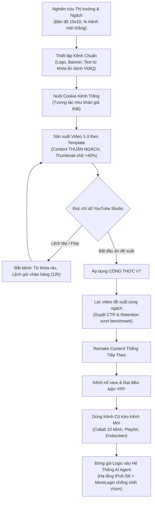

# Phân Tích Toàn Diện: Chuỗi "Hành Trình 30 Ngày Kiếm Tiền Với YouTube" (An Ong)

Tài liệu này phân tích chi tiết toàn bộ 13 video trong thư mục `/home/congnt/Documents/Codex/2026-10-27/h-y/outputs/hanh-trinh-30-ngay/`, kết hợp giữa transcript âm thanh nguyên bản (qua Whisper Groq) và các khung hình chụp màn hình thực tế (Google Sheets, YouTube Studio, kiến trúc hệ thống Agent, hợp đồng mạng VNPT, MoreLogin, và tài liệu nội bộ `34-BAN-DO-THI-TRUONG.md`).

---

## 1. Bản Đồ Tổng Quan Chuỗi Video (Executive Summary)

* **Tác giả:** An Ong (Founder ShopAPI / hệ thống AI YouTube).
* **Bối cảnh & Động lực:** Tác giả từng bế tắc, nản chí khi làm YouTube view ngoại. Động lực bắt đầu từ vợ của tác giả: đạt phong độ **5 kênh làm kênh nào bật kênh đó** (trong 1 ngày bật 2 kênh: 1 kênh 9 video, 1 kênh 30 video; chưa kênh nào vượt quá 30 video mà chưa bật kiếm tiền).
* **Mục tiêu:** Áp dụng công thức thực chiến trong 30 ngày để xây dựng kênh YouTube view ngoại bật kiếm tiền (yêu cầu: 1.000 subscriber + 4.000 giờ xem), ghi lại trung thực toàn bộ quá trình kể cả khi thất bại.
* **Mô hình triển khai:** Làm content dạng **Remake / Remix** (làm lại các nội dung đã thắng của đối thủ trong thị trường ngoại) kết hợp hệ thống tự động hóa bằng công cụ và AI Agent.

---

## 2. Phân Tích Chi Tiết Từng Video (Từ Mở Đầu đến Ngày 12)

### Video Mở đầu: Ý Tưởng & Động Lực Khởi Đầu
* **Thời lượng:** 01:27 (87.5s) | **File:** `Mở đầu - Ý tưởng - Hành trình 30 ngày làm youtube kiếm tiền [1723472608768948].mp4`
* **Nội dung chính:**
  * Thừa nhận YouTube là lĩnh vực khó nhất trong các mảng MMO đã trải qua, từng nhiều lần muốn bỏ cuộc.
  * Phân tích case study của vợ: 5 kênh liên tiếp bật kiếm tiền YPP (YouTube Partner Program), chỉ cần 8–9 video hoặc tối đa 30 video trong vòng 1 tháng.
  * Đặt cược: Cam kết tuân thủ nghiêm ngặt công thức của vợ trong 30 ngày, ghi lại nhật ký công khai.

---

### Video 01: Ngày 1 – Tìm Chủ Đề (Chọn Vùng Biển)
* **Thời lượng:** 02:17 (137.4s) | **File:** `01 - Tìm chủ đề - Hành trình 30 ngày kiếm tiền với youtube [2112433349657962].mp4`
* **Nguyên lý gốc YouTube:**
  > *"YouTube tìm video cho người xem, chứ không tìm người xem cho video."*
  * Thuật toán không tự đẩy video đi một cách mù quáng, mà nó kéo video đến những người đang có nhu cầu xem chủ đề đó. Người làm nội dung không đi tìm khán giả, mà phải **đứng đúng chỗ khán giả đang tìm kiếm**.
* **Phương pháp chọn ngách ("Nghề đánh cá" - 4 bước):**
  * Đã quét hơn 760.000 kênh trên 10 quốc gia bằng AI.
  * **Chỉ số vàng cốt lõi: Tỷ lệ Kênh Mới đang thắng (% kênh mới lập $\le 12$ tháng có video $>100k$ view).**
  * **Cạm bẫy:** Ngách kinh dị có 154 video trăm nghìn view (nhìn tưởng là mỏ vàng), nhưng chỉ có 3% là kênh mới. Tức là nhiều cá nhưng tàu lớn đã neo kín, người mới vào sẽ bị đè bẹp.
  * **Lựa chọn:** Chọn ngách **Tâm lý học** (Psychology): Tuổi kênh trung vị khoảng 13 tháng, có tới **47% kênh đang thắng là kênh mới** $\rightarrow$ Cửa biển mở cho tàu mới vào đánh bắt.

---

### Video 02: Ngày 2 – Xác Định Thị Trường & Tuyến Nội Dung
* **Thời lượng:** 02:48 (168.0s) | **File:** `02 - Hành trình 30 ngày kiếm tiền với youtube - xác định thị trường với tuyến nội dung [1377703687671619].mp4`
* **Chọn thị trường quốc gia:**
  * Dịch thô từ khóa sang từng ngôn ngữ $\rightarrow$ tìm đối thủ $\rightarrow$ lấy từ khóa chuẩn bản địa $\rightarrow$ quét toàn diện 10 nước, gom được 130 video $>100k$ view của 80 kênh.
  * So sánh 2 chỉ số: **Lượng view** và **Tuổi kênh**.
  * Thị trường Tây Ban Nha: 13 video $>100k$ view nhưng rất ít kênh mới (tàu lớn neo kín).
  * **Thị trường Nhật Bản:** 17/17 kênh đều dưới 5.3 tháng tuổi, 100% kênh mới thắng (ví dụ kênh đối thủ: 10 video đạt 19k view, 30 video đạt 23k view) $\rightarrow$ Quyết định đánh thị trường **Nhật Bản**.
* **Chọn tuyến nội dung:**
  * Kéo 629 video của đối thủ về qua tool, sắp xếp từ view cao xuống thấp.
  * Thống kê: **Chỉ 7% video đạt $>100k$ view, nhưng 7% này chiếm tới 60% tổng lượng view toàn ngách**.
  * Tư duy video đầu: Không phục vụ người xem bình thường, mà phục vụ việc **dạy thuật toán YouTube hiểu kênh thuộc tệp nào**.
  * Quyết định làm 3 tuyến nội dung để gieo xác suất. Tuyến nào có tín hiệu thì dồn lực.

---

### Video 03: Ngày 3 – Thiết Lập Kênh & Ma Trận Từ Khóa
* **Thời lượng:** 02:59 (179.7s) | **File:** `03 - Thiết lập kênh - Hành trình 30 ngày kiếm tiền với youtube [1620637799670844].mp4`
* **Nguyên tắc "Không sáng tạo cái đã win":**
  * Những gì đối thủ đang thắng tức là thị trường đã chấp nhận. Sao chép trực tiếp cấu trúc avatar/logo (dùng ảnh nhân vật anime/tâm lý đặc trưng của ngách Nhật), banner, phong cách mô tả.
* **Chiến lược từ khóa kênh (Phân loại đúng tệp từ đầu):**
  * **Chiến lược 1:** Sao chép bộ từ khóa của các kênh đang win.
  * **Chiến lược 2:** Tự xây bộ từ khóa dựa trên dữ liệu đối thủ:
    1. Đưa toàn bộ hashtag/từ khóa của 629 video đối thủ vào AI lọc các từ lặp lại nhiều nhất.
    2. Mở trình duyệt YouTube ở chế độ **Ẩn danh (Incognito)**, gõ từng từ khóa.
    3. Kiểm tra 10 video xuất hiện đầu tiên: Có bao nhiêu video thuộc ngách tâm lý giống đối thủ $\rightarrow$ Chấm điểm từ 1 đến 10. **Chỉ giữ lại từ khóa $\ge 5$ điểm**.
    4. Dùng **VidIQ** kiểm tra Search Volume của từ khóa đó.
    5. Chọn từ khóa vừa có điểm ẩn danh cao vừa có volume tìm kiếm cao làm từ khóa kênh chính.

---

### Video 04: Ngày 4 – Bảo Mật, Nuôi Cookie & Sản Xuất Video 1
* **Thời lượng:** 02:32 (152.7s) | **File:** `Ngày 04 - Hành trình 30 ngày kiếm tiền với Youtube [2061965827745612].mp4`
* **Quy trình kỹ thuật kênh mới:**
  * **Bảo mật trước khi làm kênh:** Đăng nhập Gmail $\rightarrow$ Bật 2FA ngay lập tức, điền đầy đủ email khôi phục và thông tin bảo mật.
  * Hoàn thiện vỏ kênh: Logo, banner, mô tả, xác minh số điện thoại bước 2.
  * **Kỹ thuật nuôi cookie cho kênh trắng:** Kênh mới tạo chưa có tín hiệu hành vi. Tác giả dùng chính tài khoản kênh đó đi xem video của đối thủ, bấm like, bình luận tương tác như khán giả thật. Việc này giúp tài khoản lưu cookie tệp khán giả tâm lý, đồng thời trang chủ YouTube ngập tràn video đối thủ để theo dõi trend.
* **Chiến lược sản xuất:**
  * Kênh 1 chọn hướng **Remake (Z-Mech)**: Không sản xuất thủ công từng video mà dựng 1 template chuẩn (format video, nhạc nền, font chữ, hiệu ứng), dùng tool tự động hóa sản xuất hàng loạt bằng cách nạp dữ liệu kịch bản của đối thủ vào.

---

### Video 05: Ngày 5 – Đọc Chỉ Số Video 1 & Phát Hiện Lỗi Lệch Tệp
* **Thời lượng:** 03:10 (190.9s) | **File:** `Ngày 05 - Hành trình 30 ngày kiếm tiền với Youtube [903185092578685].mp4`
* **Số liệu Video 1:** 36 view, CTR 3.1%, 1 sub.
* **Quy trình "Bắt bệnh" YouTube Studio:**
  1. *Cổng 1 (Kỹ thuật):* YouTube có phân phối (impression) không? $\rightarrow$ Có đẩy (khoảng 900 impression). Chứng minh: Máy tính, mạng, mail, kênh sạch, không bị shadowban.
  2. *Cổng 2 (Nguồn đề xuất):* Video được hiển thị cạnh video nào? Mở ra kiểm tra thì thấy: Nhạc Uchaman, ma mặc váy ngắn, bài tập thể dục cho người 60 tuổi, vợ ác lừa cả nhà $\rightarrow$ **100% không có video tâm lý nào $\rightarrow$ Bị đẩy sai tệp hoàn toàn!**
  3. *Tệp khán giả thật sự:* Trong số ít khán giả Nhật bấm vào (22 người), họ xem trung bình **6 phút 31 giây trên video 17 phút (Retention 38%)**, đóng góp **2.4 / 2.6 giờ xem (92% watch time cả video)**.
* **Nguyên nhân gốc rễ:**
  * Tiêu đề video có cụm từ *"người không hứng thú với thể thao"*, trong kịch bản có nhắc tới thể thao. Thuật toán AI của YouTube quét text và giọng nói, bắt gặp chữ "thể thao" nên tự động ném video vào pool thể thao, giải trí, bài tập người già!
* **Hành động điều chỉnh cho Video 2:**
  1. **Content thuần tâm lý 100%:** Tuyệt đối không chứa bất kỳ từ khóa nào thuộc ngách khác (chọn tiêu đề: *"Người thích ở một mình thì tinh thần mạnh mẽ hơn"*).
  2. **Thumbnail cho mobile:** Số liệu cho thấy 58% xem bằng điện thoại $\rightarrow$ Chữ trên thumbnail phải to, đậm, dễ đọc trên màn hình nhỏ.
  3. **Giữ nguyên kịch bản:** Tỷ lệ giữ chân 38% là tốt, không sửa cái đang hiệu quả.
  4. Rút ngắn độ dài video về **12 – 15 phút**.

---

### Video 06: Ngày 6 – Video 3 Lên Trang Chủ & Insight Người Già (>55 Tuổi)
* **Thời lượng:** 02:17 (137.7s) | **File:** `Ngày 06 - Hành trình 30 ngày kiếm tiền với Youtube [1708286400274624].mp4`
* **Kết quả sau điều chỉnh:**
  * Video 1 đổi title/thumb kéo lên 228 view.
  * Video 2 đạt 122 view (thuần tâm lý, giữ chân cao nhất kênh).
  * Video 3 đạt **514 view và CHÍNH THỨC ĐƯỢC LÊN TRANG CHỦ (Browse Features)**.
* **Phân tích Tab Đối tượng (Audience) của Video 3:**
  1. Tỷ lệ khán giả Nhật tăng lên **47.1%**.
  2. **Gần 100% khán giả là TRÊN 55 TUỔI** (người cao tuổi Nhật Bản).
  3. Hơn 50% xem bằng điện thoại di động.
* **Phát hiện 2 vấn đề lớn:**
  * *Vấn đề Thumbnail:* Người già mắt kém, xem trên điện thoại nếu chữ mảnh sẽ không đọc được. Chữ trên thumbnail **phải to, chiếm $>40\%$ diện tích ảnh**.
  * *Vấn đề Hook (Mở đầu):* Khán giả từ trang chủ là "khách lạnh" (cold audience). Nếu 60 giây đầu không ghim được họ lại thì họ sẽ lướt qua ngay.
  * *Giải pháp Hook:* Dùng AI viết 5 phiên bản hook mở đầu khác nhau, chọn bản tốt nhất và đối chiếu với kịch bản gốc của đối thủ để hoàn thiện.

---

### Video 07: Ngày 7 – Video 5 & 6 Flop & Phát Hiện Chu Kỳ "Máy Đi Chào Hàng"
* **Thời lượng:** 03:31 (211.4s) | **File:** `Ngày 07 - Hành trình 30 ngày kiếm tiền với Youtube [1601953424903510].mp4`
* **Bối cảnh đối nghịch:**
  * 4 video đầu rất tốt: V3 đạt 970 view, V4 đạt 875 view, CTR từ 2.1% tăng vọt lên 12%, kênh đạt 34.000 impression, 2.004 view, 93h watch time.
  * Bất ngờ: **Video 5 chỉ được 33 view, Video 6 chỉ được 49 view!**
* **Điều tra & Đưa ra 3 giả thuyết:**
  * *Giả thuyết 1 (Nhiễm tệp):* Video 3 chiếm tới 56% impression toàn kênh nhưng bị xếp cạnh phim Netflix, bóc phốt, CTR chỉ 1.9%, 100% khán giả $>55$ tuổi. Thuật toán lấy Video 3 định vị cả kênh nên kéo các video sau lệch tệp.
  * *Giả thuyết 2 (Lệch giờ "chào hàng" của thuật toán):*
    * Đo đạc thấy: Kênh mới sau khi đăng video thì **mất 11 – 15 tiếng (trung bình 12 tiếng) thuật toán mới bắt đầu phân phối đợt đầu (đi chào hàng)**.
    * Các video đầu đăng 22h Nhật $\rightarrow$ sau 12 tiếng rơi vào **10h-12h trưa hôm sau** (giờ nghỉ trưa của dân văn phòng) $\rightarrow$ người ta cầm điện thoại bấm vào xem $\rightarrow$ ăn đề xuất.
    * Video 5 & 6 đăng buổi sáng bên Nhật $\rightarrow$ sau 12 tiếng rơi vào **14h-16h chiều** (giờ cao điểm làm việc ở Nhật, không ai dùng điện thoại) $\rightarrow$ đợt test đầu tiên có 0 người bấm $\rightarrow$ YouTube coi video dở và tắt phân phối!
* **Hành động khắc phục:**
  1. Đổi giờ đăng: **Đăng vào 21h30 giờ Việt Nam (23h30 giờ Nhật)** để đợt chào hàng rơi trúng buổi trưa ngày hôm sau.
  2. Nối Thẻ (Cards) và Màn hình kết thúc (End Screen) từ các video cũ dồn traffic về Video 7 & 8.

---

### Video 08: Ngày 8 – Kênh Bùng Nổ View & Tiền Đề "Công Thức V7"
* **Thời lượng:** 01:35 (95.9s) | **File:** `Ngày 08 - Hành trình 30 ngày kiếm tiền với Youtube [1473733357914042].mp4`
* **Kết quả:** Kênh chính thức nổ view, đạt gần **1.000 view / 60 phút**. View đổ dồn về Video 7 và Video 10.
* **Nguyên lý cốt lõi:**
  * 80% tỷ lệ thắng của video nằm ở **Khâu nghiên cứu và chọn tiêu đề**.
  * Phát hiện ra phương pháp chọn đề tài dựa trên chỉ số đề xuất của các video cũ $\rightarrow$ đặt tên là **Công thức V7** (vì áp dụng thành công từ Video 7).

---

### Video 09: Ngày 9 – Tiết Lộ Chi Tiết "Công Thức V7"
* **Thời lượng:** 03:00 (180.7s) | **File:** `Ngày 09 - Hành trình 30 ngày kiếm tiền với Youtube - Công thức v7 [2114962119102648].mp4`
* **Kết quả:** Video 11 & 12 nổ view mạnh: Trong 48h đạt **hơn 40.000 view, gần 4.000 giờ xem (đạt điều kiện giờ xem bật kiếm tiền), hơn 400 sub**.
* **Bản chất Công thức V7:**
  * Chọn content tiếp theo dựa trên dữ liệu các video đối thủ đang **ĐỀ XUẤT (Suggested Traffic)** sang video của mình.
* **Quy trình 3 bước thực hiện Công thức V7:**
  * **Bước 1 (Lấy dữ liệu):** Vào YouTube Studio $\rightarrow$ Chọn video đang thắng của kênh $\rightarrow$ Vào tab *Phạm vi tiếp cận (Reach)* $\rightarrow$ Kéo xuống mục *Nội dung đề xuất video này (Content suggesting this video)*.
  * **Bước 2 (Lọc nguồn đối thủ):** Bấm nút Tải xuống / Mở Google Trang tính. Dùng hàm `=GOOGLETRANSLATE(ô_tiêu_đề, "ja", "vi")` để dịch toàn bộ tiêu đề đối thủ sang tiếng Việt. Lọc bỏ các video lạc đề, **chỉ giữ lại video đối thủ cùng ngách tâm lý**.
  * **Bước 3 (Chấm điểm bằng 2 tiêu chí vượt mốc trung bình):**
    1. *Tỷ lệ click (CTR):* Khi video của mình đứng cạnh video đối thủ đó, có bao nhiêu % khán giả bấm sang.
    2. *Thời lượng xem trung bình (Average View Duration):* Khán giả từ video đối thủ đó xem video mình bao lâu.
    * **Tiêu chuẩn chọn:** Lấy chỉ số trung bình của video mình làm mốc (ví dụ Video 11: CTR 6.25%, xem trung bình 6p14s). Bất kỳ video đối thủ nào trong bảng có **cả CTR và thời lượng xem vượt qua 2 mốc này** thì lập tức lấy chủ đề/tiêu đề đó để làm video tiếp theo!
    * *Ví dụ thực tế trong video:* Chọn được 2 đề tài cho Video 13 & 14:
      - Đề tài 1: *"Tâm lý học: Người già mua sách sẽ ra sao..."* (CTR 18.18%, avg 6:31).
      - Đề tài 2: *"Tâm lý học: Những đặc điểm đáng ngạc nhiên của người không quan tâm thị phi..."* (CTR 10.91%, 330 impression, avg 6:14).

---

### Video 10: Ngày 10 – Đo Lường V7 & Kỹ Thuật Dùng Kênh Cũ Kéo 3 Kênh Mới
* **Thời lượng:** 01:50 (110.7s) | **File:** `Ngày 10 - Kéo kênh mới - Hành trình 30 ngày kiếm tiền với youtube [1403200464610194].mp4`
* **Thống kê hiệu quả Công thức V7:**
  * Trong 16 video đã đăng, có 8 video chọn theo V7: **5 video đạt $>10.000$ view**, 3 video trượt $\rightarrow$ **Tỷ lệ thắng đạt 62.5%**.
* **Chiến lược "Dùng kênh cũ kéo 3 kênh mới":**
  * Nhân bản từ dữ liệu kênh cũ: Giữ nguyên template kịch bản và prompt, chỉ thay đổi nhân vật đại diện (character avatar), cho tool render hàng loạt video cho 3 kênh mới. Nhịp đăng: 2 ngày / 1 video.
  * **3 kỹ thuật kéo kênh mới bằng kênh cũ:**
    1. **Tính năng Mời Cộng Sự (Collaborator):** Khi đăng video trên kênh mới, gửi lời mời cộng sự sang kênh cũ (YouTube cho phép tối đa 10 cộng sự). Video sẽ hiển thị cho khán giả của cả 2 kênh $\rightarrow$ mượn tệp khán giả của kênh cũ, giúp AI YouTube nhận diện và định danh kênh mới chỉ sau 1–2 video!
    2. **Danh Sách Phát (Playlists):** Tạo playlist trên kênh cũ và nhét xen kẽ các video của kênh mới vào.
    3. **Thẻ / Màn hình kết thúc:** Chèn liên kết từ video kênh cũ sang kênh mới.
  * **Kết quả:** Kênh mới số 3 ngay video đầu tiên đã đạt **hơn 5.000 view**.

---

### Video 11: Ngày 11 – Doanh Nghiệp 1 Người Với YouTube (Định Giá 30.000$)
* **Thời lượng:** 02:06 (126.0s) | **File:** `Ngày 11 - Doanh nghiệp 1 người với Youtube - Hành trình 30 ngày kiếm tiền với ytb [855287190975603].mp4`
* **Triết lý vận hành AI Agent:**
  * Biết dùng công cụ AI sẽ ngày càng phổ biến và mất giá trị. Thứ tạo nên giá trị bền vững là **sự hiểu nghề sâu sắc (Domain Expertise)**. Tác giả tự làm bằng tay toàn bộ quy trình, kiểm chứng thành công rồi mới đóng gói logic nạp vào AI Agent.
* **Kiến trúc hệ thống Agent tự động hóa (Chạy trên Proxmox / VPS):**
  * **Đôi mắt (Radar ngách):** Chia ngách tâm lý Nhật thành **28 phân vùng**, theo dõi gần **400 kênh đối thủ**. Mỗi kênh của tác giả chốt giữ 1 vùng.
  * **Đầu óc (Phân tích dữ liệu & Radar đột biến):** Quét gần **30.000 video đối thủ**, tìm video đang bùng nổ view ở "tuổi thật" (video mới đăng 11h, 25h, 35h nhưng view tăng trưởng gấp x100, x500 so với kỳ vọng). Tự động áp dụng Công thức V7 để chọn đề tài.
  * **Đội ngũ Agent chuyên trách:**
    * `Não trung tâm` (Orchestrator)
    * `Kịch bản` (Scriptwriter Agent)
    * `Giọng đọc` (TTS / Voice Agent)
    * `Tiêu đề / SEO` (Metadata Agent)
    * `Dựng video` (Video Rendering Agent)
    * `Bàn giao / Lịch đăng` (Scheduler Agent)
    * `Đăng video & Bình luận / Ghim` (Uploader & Engagement Agent)
    * `Sức khỏe máy & Phục hồi` (Monitoring Agent)
  * **Quy trình vận hành:** Sáng họp giao nhiệm vụ $\rightarrow$ tối tự động xuất bản.
* **Kết quả:** Nhân bản từ 1 kênh ban đầu lên **8 kênh**, trong 10 ngày không cần can thiệp thủ công: 2 kênh đã đủ giờ xem bật kiếm tiền. Tuy nhiên, xuất hiện **3 kênh bị 0 view (không phân phối)**.

---

### Video 12: Ngày 12 – Xử Lý 0 View, Cách Ly Kênh & Kỹ Thuật Hạ Tầng
* **Thời lượng:** 03:46 (226.7s) | **File:** `Ngày 12 - Xử lý 0 view, cách ly kênh ytb [1138954905324585].mp4`
* **Thực trạng 8 kênh:**
  * Kênh 1: 14k view | Kênh 2: 3k view | Kênh 3: 43k view | Kênh 4: 8k view | Kênh 5: 200 view.
  * **3 kênh còn lại: 0 view (hoàn toàn không được phân phối).**
* **Nguyên nhân:** Đăng nhập 4 kênh cùng một thời điểm trên cùng một môi trường $\rightarrow$ Google quét spam thiết bị / hành vi bất thường.
* **Giải pháp 3 bài toán về Tài khoản & Kênh:**
  1. *Không biết trước mail nào được phân phối:* Làm nhiều video, đăng thử 3–5 kênh, kênh nào cắn đề xuất thì dồn nguồn lực.
  2. *Rủi ro mất kênh khi dùng mail chính:* Chuyển kênh cá nhân sang **Kênh Thương Hiệu (Brand Account)**, phân quyền quản trị (Manager) cho nhiều Gmail khác nhau làm backup.
  3. *Tránh "chết chùm" do trùng IP & Thiết bị:* Tách mỗi kênh thành một người dùng độc lập hoàn toàn.
* **Kỹ thuật hạ tầng thực chiến:**
  * **Giải pháp Mạng: Gói cước VNPT Fiber Xtra 2 (550.000 VNĐ/tháng):**
    * Cung cấp **01 IPv4 tĩnh** và đặc biệt là **01 Subnet IPv6 /56 tĩnh**.
    * Subnet `/56` chia được thành **256 dải mạng con IPv6 `/64` độc lập** (từ dải 1 đến dải 256). Google kiểm duyệt và quản lý IPv6 theo từng dải `/64`, do đó 256 dải này được Google coi là 256 đường mạng độc lập, không liên đới với nhau dù cắm chung 1 modem. Tránh hoàn toàn việc một kênh dính gậy bản quyền làm chết chùm cả dàn tài khoản.
  * **Giải pháp Trình duyệt: MoreLogin (Antidetect Browser):**
    * Mỗi profile là một máy tính ảo riêng biệt: Vân tay thiết bị (Fingerprint), Canvas, WebGL, AudioContext, Cookie và IP riêng.
  * **Bí quyết "Nuôi Profile Chrome" để tạo Gmail không cần SĐT:**
    * Profile mới tinh vào đăng ký Gmail sẽ bị bắt xác minh SĐT 100%.
    * *Quy trình nuôi 3–5 ngày:* Mở profile, chọn 1 chủ đề xuyên suốt (ví dụ: chạy bộ), dùng ChatGPT gợi ý từ khóa.
      * Ngày 1: Tìm kiếm "cách chạy bộ cho người mới bắt đầu", đọc bài viết.
      * Ngày 2: Tìm "giày chạy bộ", xem ảnh, ghé thăm các trang thương mại điện tử.
      * Ngày 3–5: Lướt web tự nhiên 10–15 phút/ngày để tích lũy cookie và lịch sử duyệt web như người thật.
    * Sau 3–5 ngày mới vào tạo Gmail $\rightarrow$ Tỷ lệ được Google cho **bỏ qua xác minh số điện thoại đạt 20% – 30%**.
* **Kết quả xử lý:** Đổi sang dàn mail/hồ sơ mới cho 4 kênh: 3 kênh lập tức được YouTube phân phối trở lại hơn 500 lượt hiển thị ban đầu.

---

## 3. Tổng Hợp Các Công Thức & Ma Trận Dữ Liệu Thực Chiến

### Bảng Chỉ Số Đo Lường & Bài Học Từng Giai Đoạn

| Video / Ngày | Trạng thái / View | Vấn đề phát hiện | Giải pháp kỹ thuật đã áp dụng | Kết quả thu được |
| :--- | :--- | :--- | :--- | :--- |
| **V1 (Ngày 4-5)** | 36 view, CTR 3.1% | Lệch tệp nghiêm trọng (đề xuất cạnh nhạc, thể thao, người già) | Content thuần 100% tâm lý; Chữ thumbnail to cho mobile | Cổng kỹ thuật thông, chứng minh kênh sạch |
| **V2 - V3 (Ngày 6)** | V2: 122v, V3: 514v | Khán giả Nhật chiếm 47.1% nhưng gần 100% là $>55$ tuổi | Chữ thumbnail chiếm $>40\%$ diện tích; Viết lại Hook 5 lần bằng AI | Video 3 chính thức được lên TRANG CHỦ |
| **V5 - V6 (Ngày 7)** | V5: 33v, V6: 49v (Flop) | Lệch giờ YouTube "đi chào hàng" (12 tiếng sau khi đăng rơi vào 14h chiều Nhật) | Đổi giờ đăng sang 21h30 VN (23h30 Nhật) để rơi trúng trưa hôm sau | Đợt chào hàng gặp đúng giờ nghỉ trưa của dân văn phòng |
| **V7 - V10 (Ngày 8-9)** | 1.000 view / 60 phút, V11-12 đạt 40k view | Cần công thức chọn đề tài chắc thắng thay vì đoán mò | Phát minh **Công thức V7**: Lọc video đề xuất đối thủ có CTR và Retention vượt benchmark | Kênh bùng nổ, đạt 4.000 giờ xem trong 48h |
| **V10 (Ngày 10)** | 5/8 video V7 $>10k$ view | Bật kiếm tiền khó, cần nhân bản nhiều kênh vệ tinh | Kỹ thuật **Mời Cộng Sự (Collab 10 kênh)** + Playlist chéo | Kênh mới số 3 đạt $>5.000$ view ngay video đầu |
| **V11 (Ngày 11)** | Vận hành 8 kênh | Quá tải khi làm thủ công nhiều kênh | Xây dựng hệ thống Agent (Radar 30k video, 28 vùng ngách, pipeline tự động) | 2 kênh đủ giờ xem, vận hành tự động trên VPS |
| **V12 (Ngày 12)** | 3/8 kênh bị 0 view | Đăng nhập nhiều kênh cùng lúc ăn spam; rủi ro chết chùm | Subnet IPv6 `/56` (256 dải `/64`) + MoreLogin + Nuôi profile Chrome tạo Gmail không cần SĐT | 3 kênh được gỡ hạn chế, có lại hơn 500 impression |

---

## 4. Những Đúc Rút Đáng Giá Nhất Cho Người Làm YouTube MMO / Automation

1. **Về thuật toán phân phối:**
   * YouTube mất từ 11 – 15 tiếng đối với kênh mới để bắt đầu mang video đi thử nghiệm. Phải tính toán giờ đăng sao cho thời điểm "đi chào hàng" rơi đúng vào khung giờ vàng của thị trường mục tiêu (giờ nghỉ trưa 11h30–13h hoặc tối 19h–22h).
   * Tiêu đề và lời thoại trong video nếu dính các từ khóa đa nghĩa (như thể thao, giải trí, ca nhạc) sẽ khiến bot AI phân loại sai pool khán giả, làm video chết yểu.
2. **Về lựa chọn ngách:**
   * Không chọn ngách chỉ vì thấy nhiều video triệu view. Phải đo lường **Tỷ lệ kênh mới dưới 12 tháng đang thắng**. Nếu tỷ lệ này $<10\%$, ngách đó đã bị các kênh lớn thâu tóm hoàn toàn.
   * View trung vị lý tưởng cho kênh mới nên nằm trong khoảng **150.000 – 600.000 view** (đủ to để có tiền, nhưng không quá khổng lồ để bị các "ông lớn" độc quyền).
3. **Về nhân bản & mở rộng (Scale):**
   * Làm thủ công đến khi nắm vững bản chất từng chỉ số (CTR, Retention, Traffic source, Audience age) rồi mới tự động hóa.
   * Để nuôi dàn tài khoản bền vững: Phải cách ly triệt để từ tầng IP (ưu tiên giải pháp IPv6 Subnet `/56` chia `/64` thay vì mua proxy trôi nổi dễ dính blacklist), vân tay máy tính (Antidetect browser như MoreLogin), và nuôi cookie lịch sử duyệt web để tăng độ uy tín (trust score) cho tài khoản Google.
